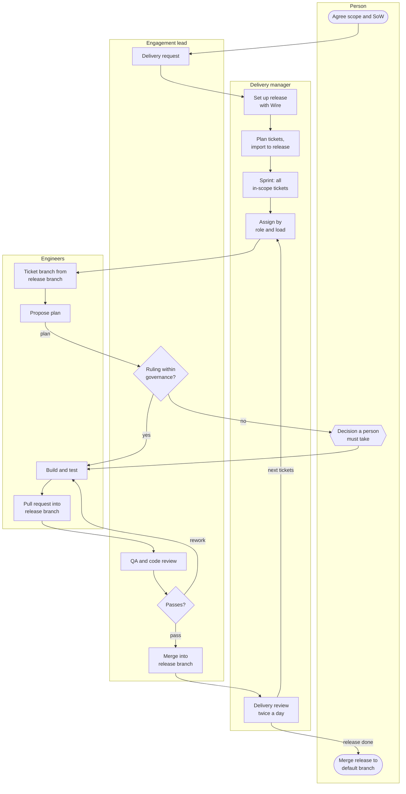

# The delivery process

:::note[Rittman Analytics only]
Hosted agents are a Rittman Analytics-only feature. Rittman Analytics runs them for its own engagements; they are not part of the Wire plugin or extension, and cannot be installed or run outside Rittman Analytics. The rest of Wire works the same without them.
:::

This is the process a pod follows from an agreed scope to merged work. Each step is done by one role; each decision point is taken by whoever the pod's [governance template](./governance) names for that kind of decision. The diagram uses the light template; under the strict template more of the decision points go to a person.

## The steps

| # | Step | Done by | Decision point | Decision kind |
|---|---|---|---|---|
| 1 | Agree the scope and statement of work | Person | | `scope_change` |
| 2 | Ask the delivery manager to deliver it: a "Delivery requested:" comment, or a request in the project's Slack channel | Engagement lead or person | | |
| 3 | Set up the release with `/wire:new`, which creates the release branch from the default branch, and publish it with `/wire:utils-pr-create` | Delivery manager or an engineer | Approve the release set-up pull request | `release_setup_standard` |
| 4 | Plan the work as tickets, one per piece an engineer can finish and review on its own, each naming its Wire commands and its role; link dependencies | Delivery manager | | `delivery_plan` |
| 5 | Link the tickets to the release with `/wire:tickets-import`, so the release is built ticket by ticket | Delivery manager | | |
| 6 | Put every in-scope ticket in the sprint and start it | Delivery manager | | `delivery_plan` |
| 7 | Assign the tickets that can start, to the engineer with the right role and the fewest open tickets | Delivery manager | | |
| 8 | Cut the ticket's branch from the release branch and propose a plan (`/wire:work`) | Engineer | Approve the plan | `work_plan_approval` |
| 9 | Build and test; ask when Wire needs a decision | Engineer | Each ruling, by its kind | `business_rule`, `design_decision`, `technical_choice`, and the always-a-person kinds |
| 10 | Publish with `/wire:utils-pr-create`; the pull request goes into the release branch and the ticket moves to QA | Engineer | | |
| 11 | QA: check the work against the ticket, and review the code against the statement of work, the requirements and the business rules | Engagement lead | Pass or fail | `qa_signoff` |
| 12 | Approve and merge the pull request into the release branch, recording what was checked | Engagement lead | | `code_merge_release` |
| 13 | Review delivery: assign tickets whose dependencies are done, chase stalled tickets and waiting reviews, raise risks with the lead | Delivery manager | | |
| 14 | Merge the release into the default branch | Person | | `code_merge_default` |

A failed QA sends the ticket back to its engineer with what to change; after a number of failed checks set by the template, it goes to a person. A ticket that cannot go on is moved to Blocked with its reason; when it waits on a review, ruling, approval or sign-off, the engagement lead is told.

## Rules that apply at every step

- **Branches and pull requests are Wire's.** Agents use the release and ticket branches Wire creates and publish through `/wire:utils-pr-create`. They never invent a branching scheme.
- **Published history is never rewritten.** No agent amends, rewords, rebases or force-pushes a commit that is already on GitHub, or deletes a branch. A correction is a new commit.
- **Agents never decide what is not theirs.** A question outside an agent's governance goes to the engagement lead; one outside the lead's goes to a person, and the agent waits.
- **Questions are asked on the Jira ticket.** Slack is for heads-ups; see [Jira, Slack and files](./jira-slack-and-files).
