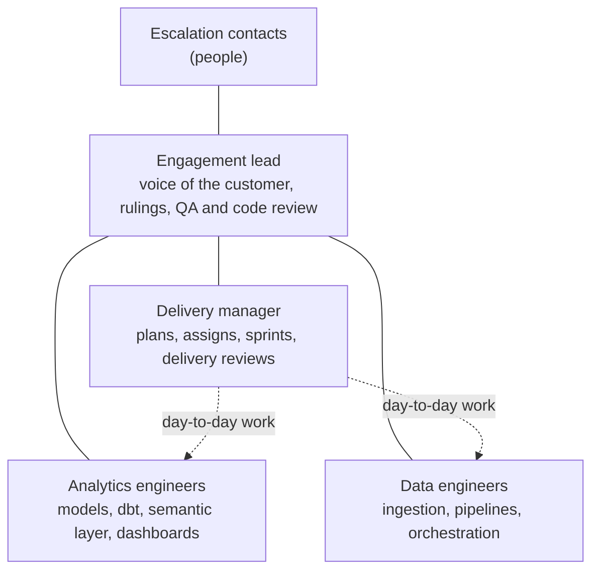
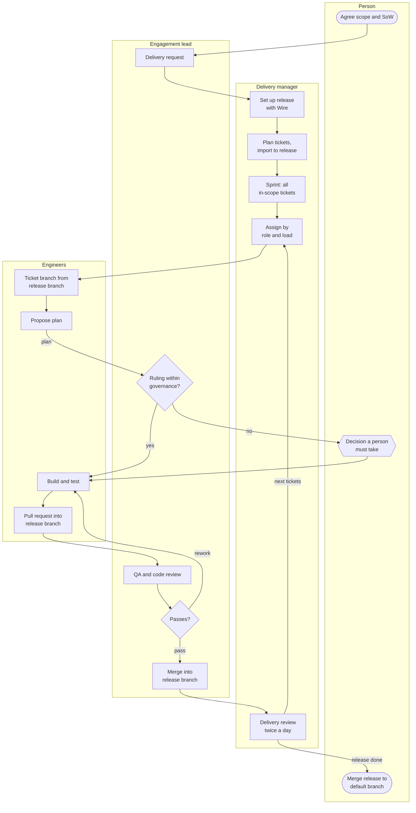
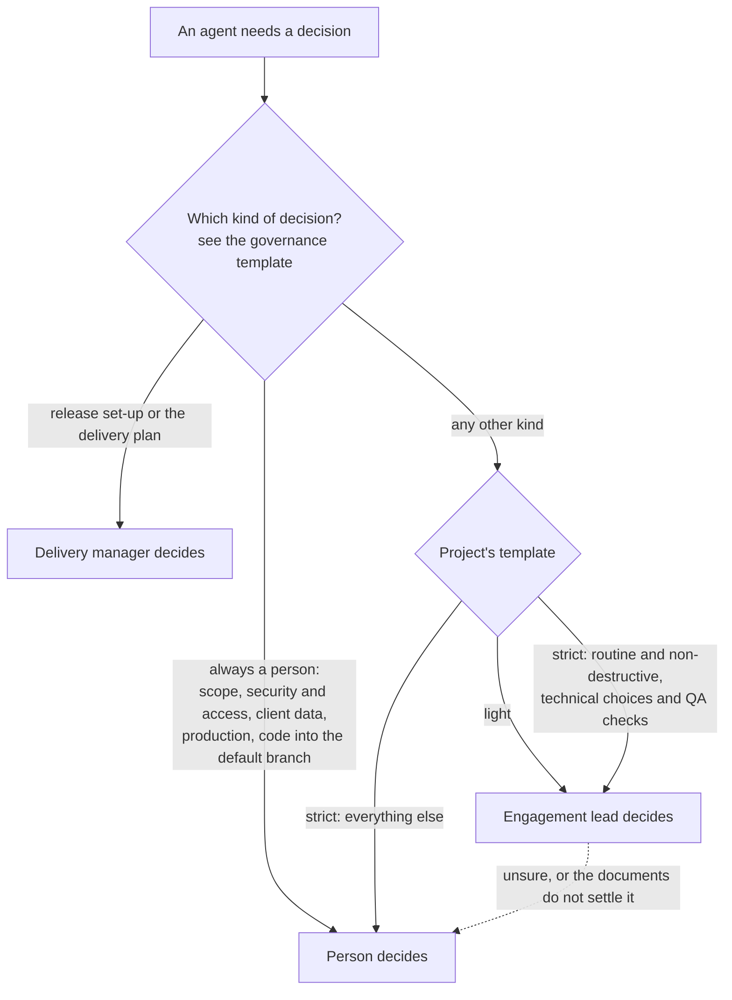

# Hosted agents: diagrams

:::note[Rittman Analytics only]
Hosted agents are a Rittman Analytics-only feature. Rittman Analytics runs them for its own engagements; they are not part of the Wire plugin or extension, and cannot be installed or run outside Rittman Analytics. The rest of Wire works the same without them.
:::

The three diagrams the other pages in this section use, together.

## Pod structure

## How work flows: who does each step

## Who takes a decision

