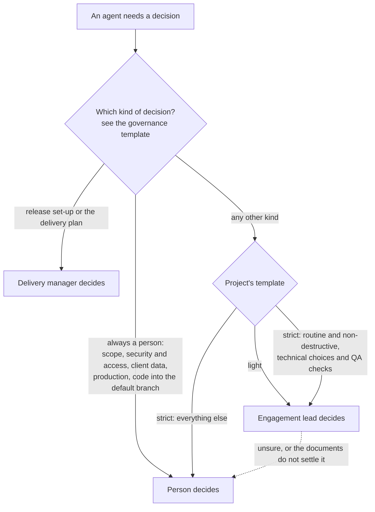

# Governance

:::note[Rittman Analytics only]
Hosted agents are a Rittman Analytics-only feature. Rittman Analytics runs them for its own engagements; they are not part of the Wire plugin or extension, and cannot be installed or run outside Rittman Analytics. The rest of Wire works the same without them.
:::

A governance template says, for every kind of decision met on a project, who takes it: the **delivery manager** or the **engagement lead** of the pod working it, or a **person** (one of the pod's escalation contacts). Each project chooses one template, on the agents console's Projects page, so a pod working several projects can be lightly governed on one and strictly on another. The agents read it at every decision, so changing a project's template changes how it is governed from the next decision on.

Templates are a [process registry](../advanced/registries) entry type, like release types and conventions: authored in the registry, synced into Wire, and checked by a validator. Two ship with Wire; more can be added.

## The kinds of decision

| Kind | What it covers | Light | Strict |
|---|---|---|---|
| `scope_change` | A change to scope, deliverables or the statement of work | Person | Person |
| `cost_or_effort` | Cost, budget, effort estimates or billing | Person | Person |
| `security_access` | Security, access, permissions, credentials or service accounts | Person | Person |
| `client_data` | Personal data, residency, retention or sharing | Person | Person |
| `client_facing` | Anything the client sees before it is signed off | Person | Person |
| `production_change` | A production deploy, a cutover, or deleting or overwriting data or code in use | Person | Person |
| `code_merge_default` | Merging code into the default branch, which can deploy to production | Person | Person |
| `business_rule` | Confirming or changing a business rule or definition | Engagement lead | Person |
| `design_decision` | Data model grain, keys and other design choices within scope | Engagement lead | Person |
| `work_plan_approval` | Approving an engineer's plan for a ticket | Engagement lead | Person |
| `sprint_addition` | Adding a minor ticket to a running sprint | Engagement lead | Person |
| `release_setup_nonstandard` | A release branch set up other than the standard way | Engagement lead | Person |
| `code_merge_release` | Merging code into a release branch, after code review | Engagement lead | Person |
| `technical_choice` | Routine technical choices within a ticket's scope | Engagement lead | Engagement lead |
| `qa_signoff` | Passing a ticket's QA | Engagement lead | Engagement lead |
| `release_setup_standard` | The standard release branch and Wire scaffolding | Delivery manager | Delivery manager |
| `delivery_plan` | Planning tickets, the sprint and assignments | Delivery manager | Delivery manager |

| Setting | Light | Strict |
|---|---|---|
| Hours an agent waits for a person's ruling before pausing | 4 | 8 |
| Failed QA checks on one ticket before a person is asked | 3 | 2 |
| Sprint length the delivery manager uses, in weeks | 2 | 2 |

### Light: the engagement lead decides all but the most significant

Use it for internal projects and for clients who want speed and are content for an experienced lead to take delivery decisions. A person decides only the seven kinds that are significant or hard to undo.

### Strict: a person decides all but the routine

Use it for regulated clients, early engagements and any client who wants to approve each step. Agents still plan, build and check the work, but plans, designs, business rules, sprint changes and every merge wait for a person. The engagement lead keeps only routine, non-destructive technical choices and the first QA check.

## Rules every template keeps

- **Five kinds are always a person's**: scope changes, security and access, client data, production changes and code merged into the default branch. The validator refuses a template that gives any of them to an agent.
- **The delivery manager decides only** the standard release set-up and the delivery plan.
- **A person not replying is never a reason to decide.** An agent waits; after the template's wait it pauses the ticket and says so.
- **The lead escalates when unsure.** Even for a kind it may decide, the engagement lead passes the question to a person when the documents do not settle it, or when the customer would reasonably expect to be asked.

## Pull request approvals

| Pull request | Decision kind |
|---|---|
| Release set-up only (Wire scaffolding under `.wire/`), into the default branch | `release_setup_standard` |
| Release set-up only, into any other branch | `release_setup_nonstandard` |
| Code into a release branch | `code_merge_release` |
| Code into the default branch | `code_merge_default` |

The agent the template names approves and merges with a plain merge, so no branch is ever deleted or rewritten. Approving code needs a written note of what was checked against the statement of work, the requirements and the business rules; it is posted on the pull request as the record of the review. Under the strict template every merge is a person's.

## Choosing and adding templates

A project's template is chosen on the agents console's Projects page; a project with none chosen is lightly governed.

To add a template, add a file to the process registry's `governance/` folder with every decision kind set, open a pull request there, and sync it into Wire. The schema is `wire/schemas/governance-schema.md`; `wire/tests/core/validate_governance.py` checks every template, including the always-a-person rule.
