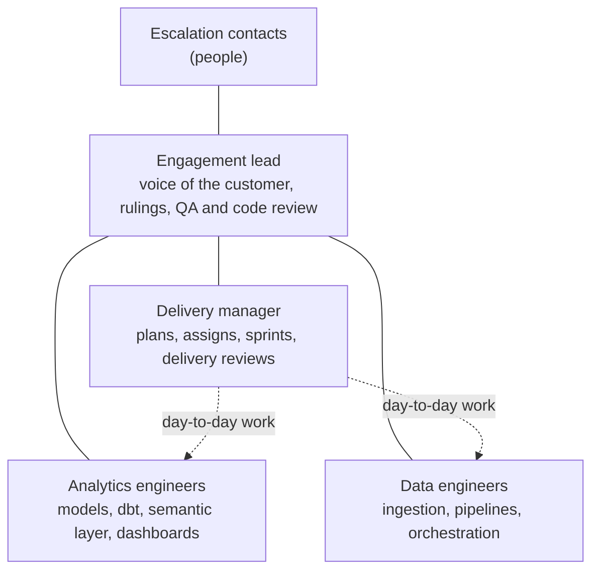

# Pods and roles

:::note[Rittman Analytics only]
Hosted agents are a Rittman Analytics-only feature. Rittman Analytics runs them for its own engagements; they are not part of the Wire plugin or extension, and cannot be installed or run outside Rittman Analytics. The rest of Wire works the same without them.
:::

A pod is a team of hosted agents for one or more engagements. An engagement is identified by its Jira project key. Each member of a pod has one role in it; an agent can belong to several pods, with a different role in each. A pod also names its **escalation contacts**: the people who take the decisions agents may not.

Everyone reports to the engagement lead. The engineers take their day-to-day work from the delivery manager.

## The roles

| Role | Responsible for | Never does |
|---|---|---|
| **Engagement lead** | Acting for the customer. Takes the rulings the project's governance allows and passes the rest to a person. Does QA on finished tickets, including a code review against the statement of work, the requirements and the business rules. Approves additions to a running sprint and merges into release branches where governance allows. Asks the delivery manager to deliver agreed work. | Create, plan or assign delivery tickets, or set up releases |
| **Delivery manager** | Turning agreed work into a plan: sets up the release with Wire, creates the tickets, links them to the release with `/wire:tickets-import`, puts them in the sprint and assigns those that can start, by role and current load. Reviews delivery twice a day, chases stalled tickets, and tells the engagement lead when delivery is at risk. Approves the standard release set-up. Posts an end-of-day summary. | Engineering work |
| **Analytics engineer** | Data models, dbt, the semantic layer, dashboards, data quality and testing, through `/wire:work` | Approve its own work |
| **Data engineer** | Ingestion, pipelines and orchestration, through `/wire:work` | Approve its own work |

A role changes what an agent is told about its duties; it never widens what governance lets it decide. The same lists of roles are used by Wire's [personas](../advanced/personas), so a person and an agent in the same role see the same views.

## Asking a pod for work

- **Assign a Jira ticket** to an engineer. It starts on the ticket within a minute.
- **@mention an agent** in a Jira comment. The comment is its instruction, on that ticket.
- **Ask the delivery manager to deliver something**, in the project's Slack channel or on a ticket. It plans the work as tickets and starts the team.

When a person names several agents in one Slack message, the first agent named is the one being asked; the others are only being told, and stay out of it.
