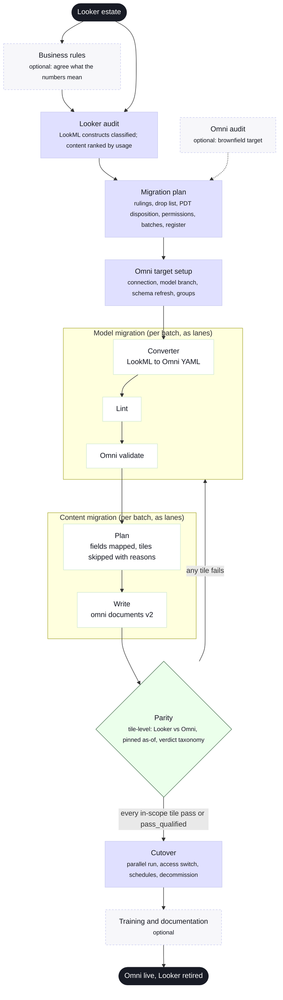

# BI Tool Migration Release

:::tip[You do not have to type these commands]

Since v4.0.0, on Claude Code, you can direct this release in plain language: say what you want done, and Wire runs the right command, tells you what it did and stops at every review gate for your decision. Typing the commands still works, and the record on disk is the same either way. See [The Release Director Model](../advanced/release-director), and the [terminal session walkthrough](../tutorials/bi-to-looker-session) for a release run this way.

:::

This release type moves a reporting layer from one BI tool to another. The warehouse and the dbt layer stay where they are. What is rebuilt, checked and switched over is the semantic model and the dashboards that sit on it.

It supports seven migration pairs. The release's `status.md` records which one with `bi_pair`.

1. [Tableau to Looker](#tableau-to-looker) (`tableau_to_looker`, experimental)
2. [Metabase to Looker](#metabase-to-looker) (`metabase_to_looker`, experimental)
3. [Looker Studio to Looker](#looker-studio-to-looker) (`looker_studio_to_looker`, experimental)
4. [Looker to Omni](#looker-to-omni) (`looker_to_omni`, the default)
5. [Tableau to Omni](#tableau-to-omni-and-metabase-to-omni) (`tableau_to_omni`, experimental)
6. [Metabase to Omni](#tableau-to-omni-and-metabase-to-omni) (`metabase_to_omni`, experimental)
7. [Looker Studio to Omni](#looker-studio-to-omni) (`looker_studio_to_omni`, experimental)

This is not the same as moving an Omni estate to a new warehouse. That is a `platform_migration` release with `migration.reporting_tool: omni`.

## How every pair runs

Every pair follows the same seven steps. Only the source audit and the target phases change from pair to pair.

| Step | What happens |
|---|---|
| 1. Business rules (optional) | Agree what the numbers mean before anything is moved |
| 2. Source audit | Snapshot the source tool, class every construct as `mechanical`, `assisted` or `redesign`, and rank content by usage |
| 3. Plan | The director's rulings (what to drop, what to redesign), batches, and a migration register with one row per object |
| 4. Target setup | Connection check, a branch for the new model, groups and user attributes |
| 5. Model and content | A deterministic converter writes the new model and dashboards, batch by batch; anything it cannot translate goes in `needs_human.json` for a person |
| 6. Parity | Each migrated tile's rows are compared with the source's rows. This is the gate for cutover |
| 7. Cutover | Parallel run, access switch, schedules recreated, the old tool retired |

The three classes decide who does the work on each construct:

| Class | Converter | Agent or consultant |
|---|---|---|
| `mechanical` | Writes it | Nothing |
| `assisted` | Writes a best effort with a note, or holds it back where a wrong guess would change a number | Confirms it or writes it by hand |
| `redesign` | Writes nothing, records the alternative | Applies the plan's ruling, or asks the director |

The converters are plain scripts: the same input always gives the same output, with no AI call. The agent's work is what the scripts cannot decide.

## Migrating to Looker

:::caution[Experimental]

The three pairs that end in Looker are experimental.

:::

Tableau, Metabase and Looker Studio each have their own way in and their own converter. They share everything else: the tool-neutral record (`wire/schemas/bi_ir-schema.md`), the plan, the Looker phases and the parity loop.

| | Tableau | Metabase | Looker Studio |
|---|---|---|---|
| Way in | REST API with a personal access token, or Desktop files | Metabase API with an API key | The report editor, in a Chrome window signed in as the consultant |
| Snapshot | `tableau_export.py` | `metabase_export.py` | `looker_studio_capture.py`, `looker_studio_extract.py` |
| What carries the model | Each workbook's data sources | Metabase's table metadata: types, primary and foreign keys | Nothing reusable, so a metric catalogue rules each metric |
| Converter | `twb_to_lookml.py` | `mb_to_lookml.py` | `ls_to_lookml.py` |
| Source rows for parity | Query View Data | Card data through the API | Chart recordings from the capture |

The three Looker phases are the same for every source:

| Phase | Artifact | Commands | What it produces |
|---|---|---|---|
| Looker target | `looker_target_setup` | `/wire:looker-target-setup-*` | Connection check, LookML migration branch, folders, groups, user attributes |
| LookML model | `lookml_model` | `/wire:lookml-model-generate --batch N`, `-lint`, `-validate`, `-review` | LookML views and explores from the converter; `needs_human.json` |
| Looker content | `looker_content` | `/wire:looker-content-*` | LookML dashboards on the branch, with filters that charts `listen` to |

Every audit runs the same six steps and keeps credentials outside the repository:

Into a LookML project that already has views, each converter writes to its own folder (`--include-root`) under a new model. The client's existing models are not touched.

### Tableau to Looker

The audit phase is `tableau_audit` (`/wire:tableau-audit-generate`, `-validate`, `-review`). It snapshots a Tableau Cloud or Server site, or Desktop files, and classes every construct.

- Copies of the same embedded data source are matched by fingerprint (connection, tables, joins, columns) and become one shared explore, if the plan agrees.
- LOD expressions, table calculations, blends, sets and join cardinality go to `needs_human.json`.
- Dashboards become LookML dashboards on the 24-column grid; quick filters become dashboard filters.
- Parity reads each sheet's rows through Query View Data. A sheet whose extract refreshed after the parity run is `INCONCLUSIVE`.

Walkthrough: [Tutorial: Tableau to Looker](../tutorials/tableau-to-looker).

### Metabase to Looker

The audit phase is `metabase_source_audit` (`/wire:metabase-source-audit-generate`, `-validate`, `-review`). It snapshots the instance through its API.

- Query-builder questions convert to shared views and explores, typed and keyed from Metabase's metadata, with joins from its foreign keys.
- Metrics become measures with their filters.
- Native SQL questions and models become views on their SQL. Simple single-table SQL is also lifted onto the table's view, as a proposal.
- Each dashboard tab becomes a LookML dashboard, with its filters.
- Parity reads each question's rows through the API, as it runs on its dashboard.

This is not the Metabase support in Platform Migration, which keeps Metabase and moves it to a new warehouse. Walkthrough: [Tutorial: Metabase to Looker](../tutorials/metabase-to-looker).

### Looker Studio to Looker

The audit and metric catalogue phases are the same as for [Looker Studio to Omni](#looker-studio-to-omni). The converter then writes LookML from each report and the ruled catalogue.

| Data source | Becomes |
|---|---|
| BigQuery table | A view on the table, with measures for the charts' aggregations and the translated calculated fields |
| BigQuery custom SQL | A view on the SQL |
| Looker Studio's Looker connector | No new LookML: the charts point at the existing explore |
| Search Console, GA4, Sheets, Funnel.io and other connectors | Listed: a pipeline task or a drop |

Calculated fields become BigQuery SQL, with Looker Studio's division as `SAFE_DIVIDE`. Each page becomes a LookML dashboard; the date range and dimension filter controls become dashboard filters. Parity compares each chart's recorded rows with the Looker element's rows.

Walkthrough: [Tutorial: Looker Studio to Looker](../tutorials/looker-studio-to-looker).

## Migrating to Omni

### Looker to Omni

LookML views and explores become Omni views and topics on a model branch. Looker dashboards and Looks become Omni dashboards. Every migrated tile is checked against Looker before users switch, and Looker is retired after a parallel run.

| Phase | Artifact | Commands | What it produces |
|---|---|---|---|
| Business rules (optional) | `business_rules` | `/wire:business-rules-*` | The register of metric definitions; LookML measures are its input |
| Audit | `looker_audit` | `/wire:looker-audit-generate`, `-validate`, `-review` | `audit/looker_audit.md`, a catalogue of every LookML construct with its class, and a catalogue of every dashboard, Look, tile and schedule with usage |
| Audit (optional) | `omni_audit` | `/wire:omni-audit-*` | Only when the client already has Omni content |
| Plan | `bi_migration_plan` | `/wire:bi-migration-plan-generate`, `-validate`, `-review` | Usage-ranked inventory, rulings, model and content batches, the migration register |
| Target | `omni_target_setup` | `/wire:omni-target-setup-generate`, `-validate`, `-review` | Connection check, model branch, schema refresh, groups and user attributes |
| Model | `omni_model` | `/wire:omni-model-generate --batch N`, `-lint`, `-validate`, `-review` | Omni views, topics and relationships on the branch; `needs_human.json` |
| Content | `omni_content` | `/wire:omni-content-generate --batch N`, `-validate`, `-review` | A plan per dashboard (fields mapped, skipped tiles with reasons), then documents created through the Omni API |
| Parity | `bi_equivalency` | `/wire:bi-equivalency-validate` | Looker and Omni results compared tile by tile; the cutover gate |
| Cutover | `cutover` | `/wire:cutover-*` | Parallel run, access switch group by group, schedules and alerts recreated, Looker read-only then retired |
| Enablement (optional) | `training`, `documentation` | `/wire:training-*`, `/wire:documentation-*` | |

**The converter.** `scripts/lookml_to_omni.py` reads the LookML project and writes the Omni model: `<SCHEMA>/<view>.view`, `<explore>.topic`, `relationships.yaml`, `needs_human.json` and a summary. Liquid, parameters, filter-only fields, persistent derived tables (PDTs), `html` and running totals are `redesign`. The full table and six worked examples are in `bi_pairs/looker_to_omni/`.

**Keeping the repos in sync.** Both client repos keep changing during the migration.

| Direction | Command | What it does |
|---|---|---|
| LookML into the delivery repo | `/wire:migration-source-register <release> lookml <github url>`, `/wire:migration-source-refresh <release> lookml` | Snapshots the LookML repo and records the commit. Every catalogue and register row carries the commit it came from |
| Changes upstream | `/wire:migration-drift-generate` (optional, on a schedule) | Finds LookML modified, removed or renamed since each object was migrated, and dashboards edited in Looker after their batch |
| Omni model back into the delivery repo | `/wire:omni-model-reverse-port` | Reads what client modellers changed in Omni and classes each file: `identical`, `client_ahead` (copied in), `delivery_ahead` (left), `conflict` (reported, never written). Run before each batch and before parity |

Without a LookML git URL the audit still runs from a local checkout, but drift checks are not available.

**Agents Schema (optional).** Once a model batch passes validation, the `agents_schema` artifact can publish the Omni model into the warehouse's `AGENTS` schema through dbt Labs' [Agents Schema](../advanced/agents-schema), so agents that query the warehouse see the new model as it lands.

**What stays manual.** Text and markdown tiles, styling and colour themes, table calculations that use runtime values, and anything written in Liquid. Each is listed for hand finishing and shows in the parity report as `not_compared`.

Walkthroughs: [Tutorial: Looker to Omni Migration](../tutorials/looker-to-omni-migration) and [Looker to Omni: A Real Run](../tutorials/looker-to-omni-real-run).

### Tableau to Omni and Metabase to Omni

:::caution[Experimental]

The Tableau to Omni and Metabase to Omni pairs are experimental.

:::

These pairs use the source audit of the matching Looker pair (`tableau_audit` or `metabase_source_audit`), then the Omni target, model and content phases of Looker to Omni.

No LookML is written on the way. The Tableau or Metabase reader works out what each table, column, calculation, join and tile becomes, and `bi_to_omni.py` writes the Omni files from that directly:

- **Views.** One per table or SQL source, as a query view (`SELECT * FROM` the table) by default, so it cannot collide with Omni's own schema view; `--bind schema` uses `schema` and `table_name` instead.
- **Omni naming.** A column dimension takes the column's name, with the source caption as its label. A measure or calculation that would take a column's name is suffixed, because in Omni a field named after the column it reads refers to itself.
- **Topics and relationships.** One topic per data source group (Tableau) or table (Metabase); joins go to the model's shared `relationships` file, which is appended to, never replaced.
- **Dashboards.** One Omni document body per dashboard, with tiles, filters, controls and layout. Each document is created on the shared model and its draft is patched with the branch, so it runs against the branch until the branch merges.
- **Not emitted, and listed.** Parameters and fields that use them, LOD expressions and table calculations, fields inside a BigQuery record column, and text cards.

Parity takes the source rows as for the Looker pairs (Query View Data, Metabase card data) and runs each Omni tile's query against the branch. Walkthrough: [Tutorial: Tableau and Metabase to Omni](../tutorials/tableau-and-metabase-to-omni).

### Looker Studio to Omni

:::caution[Experimental]

The Looker Studio to Omni pair is experimental.

:::

Looker Studio has no semantic model to convert. Each report holds its own data sources and formulas, so the same metric is often defined several ways. This pair agrees one definition per metric first, then builds the Omni model from the warehouse, not from the reports.

| Phase | Artifact | Commands | What it produces |
|---|---|---|---|
| Looker Studio audit (replaces the Looker audit) | `looker_studio_audit` | `/wire:looker-studio-audit-generate`, `-validate`, `-review` | Report definitions, data sources and calculated fields captured from the editor; the values each chart showed; BigQuery job history where access allows; catalogues with classes |
| Metric catalogue | `metric_catalogue` | `/wire:metric-catalogue-generate`, `-validate`, `-review` | Every calculated field grouped by metric and classed as a copy, an alias or a conflict. The review is the client's ruling on one definition per metric |
| Plan | `bi_migration_plan` | as for Looker to Omni | Adds a route per subject area: *map* onto an existing warehouse model, or *build* one first in a linked `dbt_development` release |

The model, content, parity and cutover phases are those of Looker to Omni. Parity compares each Omni tile with the values the Looker Studio chart showed when it was captured, so it works for every connector, including GA4 and Sheets.

The audit reads three sources:

| Route | What | Access needed |
|---|---|---|
| B | Report and data source definitions, from the editor's internal calls | View on the report; Edit on each data source |
| C | Each chart's query and the values it showed | View on the report |
| A | The SQL each BigQuery chart ran, and 180 days of usage, from job history | BigQuery Resource Viewer on the billing project |

Routes B and C use undocumented Looker Studio endpoints that Google can change. The capture needs a Google sign-in and recorded client consent, so it cannot run unattended. Walkthrough: [Tutorial: Looker Studio to Omni](../tutorials/looker-studio-to-omni).

## Under the release director

This release type was built for the [release director model](../advanced/release-director):

- **Rulings** are yours: parity or redesign per dashboard tier, the drop list (default: no views in 90 days and last viewed over 180 days ago), what to do with each PDT, permission mapping, model design, batch order, parallel-run length and cutover date.
- **Lanes** run model batches, content batches, parity sweeps and permissions in parallel. Each lane writes only its own batch folder.
- **Cost**: parity queries the same warehouse from both tools. The plan's `parity_scope` limits it to the dashboards that matter most.
- **Checks**: before a batch is reported ready, the orchestrating session re-runs the target's validator and reads verdicts from the register, not from the lane's report.

## Prerequisites

| Pair | What you need |
|---|---|
| All | `/wire:new` with release type "BI tool migration"; it asks for the source and target and records `bi_pair` |
| Tableau to Looker | `python3 -m pip install tableauserverclient`; a Tableau personal access token (a site administrator may need to allow token creation), kept in a file outside the repo that only you can read; Site Role Explorer or higher with download permission. See [before you start](../tutorials/tableau-to-looker#before-you-start) |
| Metabase to Looker | `python3 -m pip install requests sqlglot`; a Metabase API key in a group that can see the content, kept outside the repo; the databases in scope synced in Metabase. See [before you start](../tutorials/metabase-to-looker#before-you-start) |
| Looker Studio (either target) | `python3 -m pip install playwright` and Google Chrome; the access listed for Looker Studio to Omni; who approved automated read-only access to the reports |
| Any Looker target | The client's LookML repo, Looker API access, and a Looker developer and admin to deploy and configure the new model |
| Tableau to Omni, Metabase to Omni | The source access of the matching Looker pair; the Omni CLI with a profile that can create a model branch, write model YAML and create documents |
| Looker to Omni | The LookML repo cloned locally; Looker API credentials with System Activity access; the Omni CLI and an API key that can create a model branch and documents; the `omni-analytics` agent skills (`/plugin marketplace add exploreomni/omni-agent-skills`, `/plugin install omni-analytics@omni-analytics`) |

## See also

- [A session at the terminal: Tableau, Metabase and Looker Studio to Looker](../tutorials/bi-to-looker-session)
- [Tutorial: Tableau to Looker](../tutorials/tableau-to-looker)
- [Tutorial: Metabase to Looker](../tutorials/metabase-to-looker)
- [Tutorial: Looker Studio to Looker](../tutorials/looker-studio-to-looker)
- [Tutorial: Looker to Omni Migration](../tutorials/looker-to-omni-migration)
- [Looker to Omni: A Real Run](../tutorials/looker-to-omni-real-run)
- [Tutorial: Tableau and Metabase to Omni](../tutorials/tableau-and-metabase-to-omni)
- [Tutorial: Looker Studio to Omni](../tutorials/looker-studio-to-omni)
- [Platform Migration](./platform-migration): the same register and drift checks applied to a warehouse move
