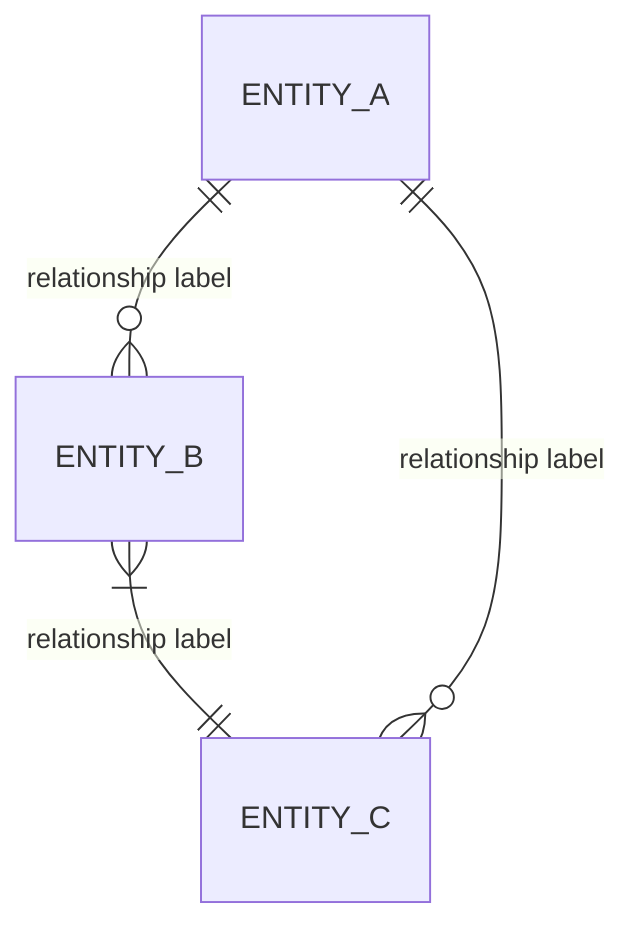

## Auto-Delegation

Follow `specs/utils/precondition_gate.md` before proceeding.

---

# Conceptual Model Generate Command

Follow `specs/utils/data_designer_delegate.md` before executing the workflow below.

## Purpose

Generate a business-level conceptual entity model showing the core domain entities, their high-level attributes, and their relationships — without implementation detail such as column names, data types, or dbt layering. This model is presented to business stakeholders for approval before pipeline architecture and detailed data modelling begins.

The conceptual model captures *what the business cares about*, not *how the database stores it*. Its primary purpose is to ensure consultant and client agree on the entity landscape before design decisions are made.

## Usage

```bash
/wire:conceptual_model-generate YYYYMMDD_project_name
```

## Prerequisites

- `requirements`: `review: approved` — the conceptual model is derived from approved requirements

## Workflow

### Step 1: Verify Prerequisites and Read Inputs

1. Read `.wire/<project_id>/status.md`
2. Check `requirements.review == approved`. If not:
   ```
   Error: Requirements must be approved before generating the conceptual model.
   Run: /wire:requirements-review <project_id>
   ```
3. Read `.wire/<project_id>/requirements/requirements_specification.md`
4. Use Glob to find all files in `.wire/<project_id>/artifacts/**/*`
5. Read any source schema examples, ERDs, domain glossaries, or data dictionaries found in `artifacts/`

### Step 1.5: Ask Before Drafting

Look for the answers below in the requirements and artifacts first. Ask the client only the questions they leave open, together in one message, before drafting.

1. **Business questions.** What are the key questions the model must answer? List them in the client's words.
2. **Near-term uses.** What uses are expected soon that the requirements do not cover, such as another team, a planned dashboard, or AI tools querying the semantic layer? These decide which attributes are worth carrying. They do not bring new entities into scope.

Record the answers in the document's Business Questions section, each with its source: the requirement it came from, or who answered and when. If the client cannot answer before the draft, draft anyway and list the open questions in Section 5.

The grain of each fact and the client's naming conventions are asked later, by `data_model-generate` Step 1.7, where tables are designed.

### Step 2: Extract Business Entities

From the requirements specification and artifacts, identify all **business entities** — the things the business tracks, measures, or cares about. Look for:
- Nouns in functional requirements (FR-* sections)
- Data sources named in the pipeline scope
- Reporting subjects mentioned in deliverables
- Entities implied by relationships (e.g. if "a student is enrolled on a course", both `Student` and `Course` are entities)

For each entity record:
- **Name**: Singular noun, PascalCase (e.g. `Student`, `Enrolment`, `PastoralNote`, `Invoice`)
- **Description**: One sentence explaining what this entity represents in business terms
- **Key business attributes**: 3–6 high-level attributes described in business language (not column names)
- **Approximate volume**: Row count or transaction frequency if known from requirements

Group entities by domain if the project spans multiple subject areas (e.g. Academic, Finance, HR).

**A thing, or a fact about a thing.** Before recording an entity, ask which it is:

- A **thing** has its own identity and sets what one row means: an order, a customer, a supplier.
- A **fact about a thing** is a detail, amount, status or date that only makes sense attached to it: order status, approval date, order total. It is a key attribute of that entity, not a new entity.

A status, a workflow stage, or the date a thing reached a milestone is never an entity on its own. A related concept is a separate entity only when one row means something different, such as `Order` (one row per order) and `OrderLine` (one row per item on an order). Treat a name that joins two existing entities, carries a filter or type (`WebOrder`), or stacks nouns (`OrderStatusHistory`) as a warning sign: it usually points to a relationship, a filter or attributes of an existing entity. When unsure, record it as an attribute and add the question to Section 5. The full guidance is in the conceptual model design guide (https://docs.rittmananalytics.com/en/latest/docs/guides/conceptual-model-design).

A calendar the business reports by (`Date`, or a fiscal calendar) is an entity like any other, so every warehouse dimension built later has an entity to map to.

**Agreed summaries.** A summary across business areas that is hard to work out at query time (for example customer churn, built from subscriptions, payments and support contacts) is not an entity. If the requirements need one, list it under Agreed Summaries with the entities it is built from. A table that combines several facts at one shared grain, such as an event stream, is listed there too. `data_model-validate` accepts a new `_xa` warehouse model built for this reason only when its summary is listed there.

### Step 3: Define Relationships

For each pair of related entities, define:
- **Relationship label**: Verb phrase describing the relationship from Entity A's perspective (e.g. "enrolled in", "authors", "generates", "is subject of")
- **Cardinality**: Standard ERD notation:
  - `||--||` : exactly one to exactly one
  - `||--o{` : exactly one to zero or more
  - `}|--||` : one or more to exactly one
  - `}o--o{` : zero or more to zero or more

Flag any relationships that are ambiguous or require business clarification — add them to Section 5 (Open Questions) rather than silently resolving them.

### Step 4: Generate Conceptual Model Document

Apply the reference-legibility convention (`specs/utils/reference_legibility.md`): wherever the document cites a functional requirement code (FR-n) from the requirements specification, pair it with the requirement's plain-language name at first mention and resolve it in the Reference key section at the end of the template.

Write to `.wire/<project_id>/design/conceptual_model.md`:

```markdown
# Conceptual Entity Model: [Project Name]

**Client**: [Client Name]
**Project ID**: [Project ID]
**Generated**: [Date]
**Version**: 1.0
**Status**: Draft — awaiting business stakeholder review

## Business Questions

| Question or near-term use | Source |
|---------------------------|--------|
| [e.g. "Which stores are understaffed at peak hours?"] | [FR-n, or who answered and when] |

## 1. Entity Inventory

### [Entity Name]
**Description**: [One sentence business description]
**Key attributes**: [attribute 1], [attribute 2], [attribute 3], [attribute 4]
**Approximate volume**: [e.g. ~4,000 students; ~500 transactions/day; updated daily]

[Repeat for each entity, grouped by domain if applicable]

### Agreed Summaries

| Summary | Built from | Why it is not worked out at query time |
|---------|------------|-----------------------------------------|
| [e.g. CustomerChurn] | [Subscription, Payment, SupportContact] | [reason] |

[Omit this subsection if there are none]

## 2. Entity Relationship Diagram



**How to read this diagram**:
- `||` = exactly one
- `o{` = zero or more
- `}|` = one or more
- Labels describe the relationship from left entity's perspective

## 3. Relationship Narrative

**[Entity A] → [Entity B]** ("relationship label"): [One sentence explaining the business meaning of this relationship and why it matters to the engagement. Include any business rules that govern it.]

[Repeat for each significant relationship]

## 4. Entities Considered But Out of Scope

| Entity | Reason excluded |
|--------|----------------|
| [Entity name] | [e.g. "Out of scope per SOW Section 8.2"] |

## 5. Open Questions

| # | Question | Impact |
|---|----------|--------|
| OQ-1 | [Entity boundary or relationship that needs business clarification] | [What design decision this blocks] |

[Leave empty if no open questions]

## Reference key

Codes used in this document that are defined in other artifacts:

| Code | Meaning | Defined in |
|------|---------|------------|
| FR-[n] | [requirement plain-language name] | requirements/requirements_specification.md |

[Omit this section if the document cites no codes defined elsewhere]
```

### Step 5: Update Status

Read and update `.wire/<project_id>/status.md` YAML frontmatter:

```yaml
conceptual_model:
  generate: complete
  validate: not_started
  review: not_started
  file: design/conceptual_model.md
  generated_date: [today]
```

If `current_phase` is still `requirements`, update to `design`.

### Step 6: Sync to Jira (Optional)

Follow the Jira sync workflow in `specs/utils/jira_sync.md`:
- Artifact: `conceptual_model`
- Action: `generate`
- Status: the generate state just written to status.md

### Step 7: Sync to Document Store (Optional)

If a document store is configured for this project, follow the workflow in `specs/utils/docstore_sync.md`:
- `artifact_id`: `conceptual_model`
- `artifact_name`: `Conceptual Model`
- `file_path`: `.wire/releases/[release_folder]/design/conceptual_model.md`
- `project_id`: the release folder path (e.g. `releases/01-discovery`)

If docstore sync fails, log the error and continue — do not block the generate command.

### Step 8: Confirm and Suggest Next Steps

```
## Conceptual Model Generated

**File**: .wire/<project_id>/design/conceptual_model.md

**Entities identified**: [count]
**Relationships defined**: [count]
**Open questions**: [count — flag prominently if > 0]

### Next Steps

1. Validate the model:
   /wire:conceptual_model-validate <project_id>

2. After validation, review with business stakeholders:
   /wire:conceptual_model-review <project_id>

   NOTE: Review audience should include business stakeholders (not just technical
   leads) — the purpose is to confirm the entity landscape before design begins.
   Open questions must be resolved before the review can be approved.
```

## Edge Cases

### Ambiguous Entity Boundaries

If two concepts could reasonably be one entity or two (e.g. `Student` vs `Learner`; `Invoice` vs `Bill`; `Attendance` vs `AttendanceMark`):
- Use the client's own terminology from the SOW
- Document the ambiguity in Section 5 (Open Questions)
- Do not silently resolve — this is a business decision, not a technical one

### No Source Schema in Artifacts

If no schema examples are in `artifacts/`, generate entities from requirements alone and add:
```
Note: No source schema examples were found in artifacts/. Entities were derived
from requirements only. Adding source schema examples before review may reveal
additional entities or relationship corrections.
```

### Very Large Domain (20+ entities)

If the engagement spans a large domain:
1. Focus on entities that are **in scope** for this engagement
2. Show out-of-scope entities in Section 4 (greyed out in diagram if possible)
3. Consider grouping entities into subgraphs in the Mermaid diagram using `subgraph`

## Output

This command creates:
- `.wire/<project_id>/design/conceptual_model.md`
- Updates `.wire/<project_id>/status.md`


---

## `model_source: modality`

When `status.md` has `model_source: modality`, read the client's existing Modality
model as the input to the sections named below.

What this command takes from the model: Section 1 from `domain` and `entity` blocks, Section 2's ERD from the resolved cardinality, Section 3's narrative from `description` and `business_logic`. Follow
`specs/utils/mml_import.md` first: it carries the block grammar, the two
vocabularies the specification and the application disagree on, and the
cardinality resolution order.

The model does not replace the requirements. Both are read, and the difference
between them is itself a finding:

- An entity in the model and not in the requirements goes in the excluded list
  with the reason "in the Modality model, not in requirements scope". It is not
  silently carried into scope.
- An entity in the requirements and not in the model goes in the open questions.
  It is not silently added to the model's entity set.

Every value taken from the model cites the `.mml` file it came from. A reader
comparing the Wire document against the model needs to know which claims came from
where, and a later write-back needs to know which claims are new.

`validate` runs the `modality_coverage` check in both directions. Its rules,
including the ones about what absence means, are in `specs/utils/mml_import.md`.
