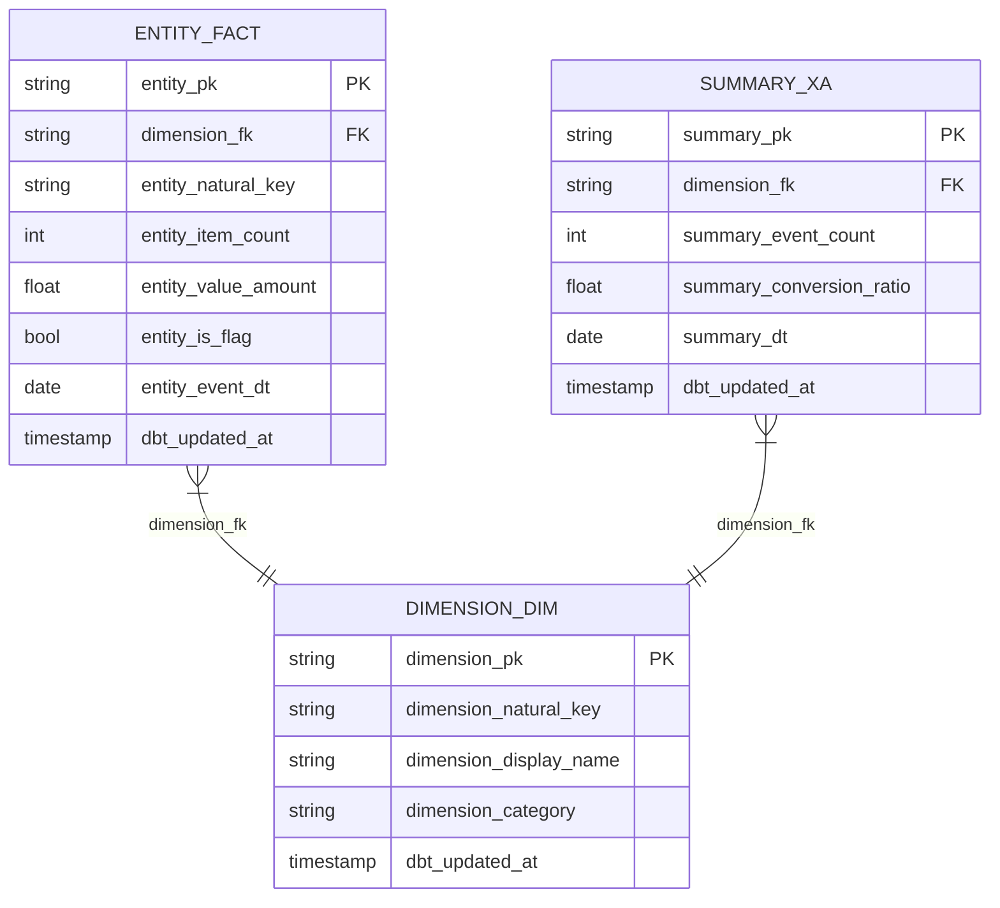

## Auto-Delegation

Follow `specs/utils/precondition_gate.md` before proceeding.

---

# Data Model Generate Command

Follow `specs/utils/data_designer_delegate.md` before executing the workflow below.

## Purpose

Generate the full dbt-layer data model specification — covering staging, integration, and warehouse layers — together with a **Physical Entity-Relationship Diagram (ERD)** as a Mermaid erDiagram showing every model with its columns, primary keys, foreign keys, and relationships. This is the primary input for dbt code generation.

The data model specification narrows the LLM's generation space for the dbt phase: every model name, column name, join path, surrogate key composition, and test definition is determined here, not during code generation.

## Usage

```bash
/wire:data_model-generate YYYYMMDD_project_name
```

## Prerequisites

**Default** (all project types except `dashboard_first`):
- `requirements`: `review: approved`
- `conceptual_model`: `review: approved` — provides the entity framework
- `pipeline_design`: `review: approved` — provides source table names and replication details

**Dashboard-first** (`dashboard_first` project type):
- `requirements`: `review: approved`
- `viz_catalog`: `generate: complete` — provides the measures, dimensions, and dashboard structure

## Sliced runs (`--slice`)

In a release built from tickets (`delivery: tickets` in `status.md`), this
command takes `--slice <slice>` and reads and writes the slice's table section of `design/data_model.md` only
(`specs/utils/ticket_delivery.md`, "The `--slice` option"). Without
`--slice`, the workflow below runs as written.

1. The slice must be in `tickets.yaml`. If it is not, stop and list the valid
   slices.
2. The precondition gate evaluates this slice's dependencies, not the whole
   release's (`specs/utils/precondition_gate.md`, "Sliced runs").
3. Add or replace the slice's part only. Never regenerate the whole document
   or project to change one slice; every other line stays as it is.
4. On a ticket branch, write the step's result to the ticket record's front
   matter (`results:`) and the log row to the ticket run log
   (`iterations/<ticket>.execution_log.md`), not to `status.md` and
   `execution_log.md`. The status and Jira or Linear updates in the workflow
   below are made by `/wire:status-sync`'s ticket roll-up when the pull request
   merges.

**Design source.** Before Step 1, run
`python3 <wire>/scripts/ticket_delivery.py design-source <release> --slice <slice>`:

- `wire_data_model`: design the slice's tables as the workflow below does.
- `modality_physical`: the slice's table is designed in the Modality physical
  model. Read it per `specs/utils/mml_import.md` ("The physical layer as a
  design source") and record it as the slice's section of
  `design/data_model.md`, with a **Source: Modality** line naming the file and
  block. Do not design the table again. List every gap against Wire's naming
  rules (`wire/conventions/dbt.yml`) as a row: what the model says, the Wire
  form, and that the consultant decides. Never write the Modality file.
- `wire_data_model_from_modality`: design the slice's tables from the Modality
  conceptual and logical layers as the workflow below does, and say that the
  physical layer has no table for this slice.

The same applies to an unsliced run in a release with `model_source: modality`
whose physical layer holds tables: each table found there is recorded, not
redesigned.

## Workflow

### Step 1: Verify Prerequisites and Read Inputs

1. Read `.wire/<project_id>/status.md`
2. Read `project_type` from frontmatter
3. **If `dashboard_first`**:
   - Verify `requirements.review` is `approved` and `viz_catalog.generate` is `complete`
   - Read the following in order:
     - `requirements/requirements_specification.md`
     - `design/visualization_catalog.md` (measures, dimensions, dashboard structure)
     - `design/dashboard_spec.md` (dashboard purpose and layout)
   - Also read `artifacts/` for SOW and domain context
4. **Otherwise (default)**:
   - Verify all three default prerequisites are met. For each that is not:
     ```
     Error: [artifact] must be approved before data model generation.
     Run: /wire:[artifact]:review <project_id>
     ```
   - Read the following in order:
     - `requirements/requirements_specification.md`
     - `design/conceptual_model.md` (entities, relationships)
     - `design/pipeline_architecture.md` (source tables, staging model names)
     - `design/logical_model.md` **if it exists** (keys, cardinality, identity
       resolution, normalisation and attribution decisions). `logical_model` is
       optional, so its absence is normal and not an error. When it is present it
       is authoritative for the decisions it records, and this command uses them
       rather than re-deriving them: the primary key of an entity and why, the
       cardinality and the foreign keys that carry it, and where normalisation
       was deliberately traded away. Re-deriving them here is the duplication
       `logical_model` exists to remove, and the two answers will not always
       agree.
4. Use Glob to find all files in `.wire/<project_id>/artifacts/**/*`
5. Read any source schema examples, existing dbt models, or SQL files in `artifacts/`

### Step 1.5: Check for a Canonical Vertical Match (Automatic, Advisory)

This step runs automatically on every engagement — there's no opt-in flag to set. It has three possible outcomes: a proposal to the practitioner, a silent skip, or (if declined) no effect on anything downstream. It can never fail the command and never blocks Step 2.

1. **Resolve the registry location, dev mode first:**
   - Check for `wire/data-model-registry/` in the repo root (present only when developing Wire itself, from `wire/scripts/sync-data-model-registry.sh`).
   - If not found, check `~/.wire/data-model-registry/` (present only if this consultant has personally run `/wire:utils-data-model-registry-setup` and has access to the private `wire-data-model-registry` repo).
   - If neither exists, **skip silently to Step 2** — no message, no note in the output spec. Most engagements and most consultants will land here; this is expected, not a degraded path.

2. **Resolve the vertical, in two tiers — don't stop at "no exact match":**
   - Read `.wire/engagement/context.md`. If `data_model_registry.vertical` is already set to a non-null value (a consultant can set this by hand at any time), use it directly as a **confident match** and skip to Step 3.
   - Otherwise, list `<registry_root>/verticals/` to see what's actually there right now — **do not assume a fixed set of names**. The registry evolves independently of this spec and of Wire's own release cycle; it started with six verticals, has since had more added, and will likely keep growing. Treat whatever's in that directory at the moment this command runs as the real, current list, and read each one's own schema descriptions (each vertical's schemas sit at `<registry_root>/verticals/<vertical>/schemas/<schema>/<schema>.yml`, one directory per schema, holding the YAML alongside a `<schema>.dbml` ERD, so the YAML is not directly in `schemas/`) to judge fit rather than string-matching the industry name:
     - **Confident match**: the client's actual business is recognizably an instance of one of the verticals actually present — e.g. a retail e-commerce client against `retail`, or a B2B SaaS client against a `saas` vertical, if one exists in the registry at the time.
     - **Adjacent match**: no vertical currently in the registry is a confident fit, but one vertical's entity *shape* is still structurally close to what this client needs, even though that vertical was built from a different kind of business. A gap like "no vertical for this specific industry yet" is not a reason to propose nothing — e.g. if no vertical matches a B2B SaaS client confidently, `subscription-commerce`'s subscriber/subscription/subscription_event/monthly_retention/subscription_revenue entities may still be a structurally close analogue for an MRR/NRR model, even though that vertical's content was built from a different kind of subscription business. Propose an adjacent match explicitly labeled as approximate — don't silently withhold it just because it isn't a clean industry match.
   - If neither a confident nor an adjacent vertical exists, proceed to Step 3 with no vertical candidate at all — this remains a normal, common outcome, not a failure.

3. **Independently check cross-vertical patterns — this runs regardless of what Step 2 found, and gets the same confident/adjacent tiering Step 2 uses.** Cross-vertical relevance is not conditional on having a vertical match; a client can need `crm_identity_resolution` (reconciling contacts/accounts across two or more CRM/marketing tools — a routine problem for any B2B business, `saas` vertical or not) whether or not any vertical matched at all.
   - Read `<registry_root>/cross-vertical/schemas/*/*.yml` and check each one against this client's actual sources, entities, and requirements — e.g. `crm_identity_resolution` for multi-system contact/account reconciliation, `ga4_ecommerce` if the client uses GA4, `multi_touch_attribution` for paid media across channels, `finance_revenue_recognition` if ASC 606-style deferred revenue is in scope. Respect each schema's `depends_on_schemas` field for sequencing (e.g. `ga4_ecommerce` depends on `event_tracking_and_sessionization`).
   - **A schema's own description names a specific originating context (e.g. "for a consultancy's or agency's own CRM operations"). Treat that as who it happened to be built for, not as a boundary on who can use it.** Look past the described origin and ask the same question Step 2 asks for verticals: is the underlying entity shape and technique still structurally the same problem this client actually has? `crm_identity_resolution`'s stated framing is an agency reconciling contacts across its own CRM tools — but the technique (union multiple CRM sources, resolve identity by email/domain matching, produce one canonical `contact_pk`/`company_pk`) is the same technique a client needs for its own multi-CRM contact-mismatch problem, regardless of what kind of business that client runs. Reject a cross-vertical schema for being a poor structural fit — different entities, different join shape, a problem this client doesn't actually have — never merely for being described for a different kind of organization than this client.
   - Distinguish, the same way Step 2 does:
     - **Confident**: the schema's own description already matches this client's situation in substance, regardless of the specific words used to frame it.
     - **Adjacent**: the description frames it around a different kind of organization, but the entities and technique are still the same underlying problem — propose it, explicitly noting the reframe (e.g. "built for an agency's own CRM reconciliation, but the same technique applies to your client's own CRM systems").
   - If Step 2 found nothing and this step finds nothing either (confident or adjacent), **skip silently to Step 2 of the main workflow** (Define Source Definitions) — no message, no note. This remains the majority-case, expected outcome for most engagements.

3b. **If the client has an authoritative model of their own, the proposal is a
   comparison, not a starting structure.** When `status.md` has
   `model_source: modality`, the entity set, keys and cardinality already came
   from the client's own model, by way of `conceptual_model` and, if it ran,
   `logical_model`. The registry proposal does not replace that. Present it as a
   comparison against what the client already authored, and name every
   disagreement rather than resolving one silently. Three kinds recur:

   - **An entity the registry has and the client's model does not.** Do not add
     it because the registry lists it as core. Say the registry expects it, say
     the client's model does not carry it, and ask. Where the requirements also
     put it out of scope, that is three sources agreeing and it is simply
     excluded, with the reason recorded.
   - **An entity the client's model has and the registry does not.** Keep it.
     `conceptual_model` already accounted for it; carry that reason forward
     rather than re-deriving or dropping it.
   - **A grain the registry splits and the client's model does not, or the
     reverse.** This is the one that quietly restructures a client's model. A
     registry schema proposing an order-header and an order-line fact where the
     client's model carries a single entity is a real design question about
     grain, not a naming difference. State both grains, state which was taken,
     and record why. `data_model-validate`'s Canonical Vertical Comparison
     already reports a grain that "notably diverges"; this makes the decision
     deliberate rather than something that check discovers afterwards.

   Where the registry and the client's model disagree and the requirements settle
   it, the requirements settle it, and the divergence from the registry is
   recorded. The 4-4-5 versus 4-5-4 retail calendar is the worked example: the
   registry's structure is worth keeping, its seed contents are not, and a
   confident vertical match adopted unread would ship the wrong calendar.

4. **Propose whatever was found, tiered by confidence — never auto-adopt:**
   - **Confident vertical match**: present as a strong proposal:
     ```
     Wire found a canonical data model that may fit this engagement: [vertical] — [schema_name].
     Standard marts: [list from standard_marts]
     Entities: [list]

     Use this as the starting structure for the data model? (yes / adapt / no)
     ```
   - **Adjacent vertical match only**: present with the mismatch stated plainly, not hidden:
     ```
     No vertical in the registry is an exact industry match for [client's actual industry] — there's no
     [inferred missing vertical, e.g. "saas"] vertical yet. The closest available entity shape is
     [vertical] — built from [what that vertical's content actually covers], not [client's industry].
     Entities: [list]

     This may still be a reasonable starting point for [specific reason, e.g. "the MRR/NRR model"].
     Worth using loosely, or skip entirely? (yes / adapt / no)
     ```
   - **Cross-vertical pattern(s)** found in Step 3 — present alongside whichever vertical proposal exists above, or on their own if no vertical proposal exists at all. If confident:
     ```
     Also relevant regardless of industry fit: [cross-vertical schema name] — [one-line reason
     specific to this client's actual requirements/sources].
     Include this pattern too? (yes / adapt / no)
     ```
     If adjacent — say so plainly rather than silently reframing it:
     ```
     Also potentially relevant: [cross-vertical schema name] — built for [the schema's stated
     originating context, e.g. "an agency's own CRM operations"], but the same technique
     ([one line on the actual mechanism]) applies to [this client's actual situation].
     Worth using loosely, or skip entirely? (yes / adapt / no)
     ```
   - **yes** (any of the above) — use the proposed entity list, grain, and naming as a baseline for Steps 2–7, adjusted for this client's actual source systems and column names. For a vertical match (confident or adjacent), record `data_model_registry.vertical: <vertical>` in `.wire/engagement/context.md` if not already set. For accepted cross-vertical patterns, record them in `data_model_registry.cross_vertical_schemas: [<schema_name>, ...]` (append, don't overwrite).
   - **adapt** — ask which specific entities/marts to keep, drop, or rename; use the rest as-is. Record as above.
   - **no** — proceed with Step 2 onward exactly as if that specific match were never proposed. Do not write it to context.md — an explicit decline should not get treated as a manual override on the next run. Worth a one-line note in the spec that a match existed but wasn't used (useful signal for the registry's own maintainers), but no other effect. Each proposal (vertical, cross-vertical) is decided independently — declining one doesn't decline the other.

5. For every model in the final data model that maps to a canonical entity (whether from a confident match, an adjacent match, or an accepted cross-vertical pattern, adopted as-is or adapted), carry that entity's `generation_constraints` and `reference_implementation` pointer(s) forward into that model's spec entry in Step 5 (or Step 3 for staging). This is the only place the registry's worked-example SQL becomes reachable — `dbt-generate` reads `data_model_specification.md` as its primary input either way, so it inherits these pointers automatically; no changes to `dbt-generate` itself are needed. Treat `reference_implementation` strictly as a worked example to read and adapt, never to copy verbatim — the registry's own README is explicit that a specific `.sql` file is not reusable across clients, only the pattern it demonstrates is.

### Step 1.6: Settle the Naming Form

New designs use the current naming form (the RA dbt development reference). Existing models, columns, seeds, snapshots and schemas are never renamed or moved.

1. **New dbt project** (no existing `dbt_project.yml` with models in the client repository): use the current form throughout. No ruling is needed.
2. **Existing dbt project**: read the project's `.wire/conventions/dbt.yml` if present, and the release's `decisions.md`. If either records a `form_choices:` ruling, follow it:

   | Key | Current form | Older form |
   |-----|--------------|------------|
   | `model_name_number` | `plural` staging and integration names (`stg_source_a__users`) | `singular` (`stg_source_a__user`) |
   | `column_prefix` | `entity` (`user_name`, `user_is_active`) | `none` (`name`, `is_active`) |
   | `test_key` | `data_tests` | `tests` |
   | `source_file_name` | `_sources` (`_sources.yml`) | `_<source>__sources` |

3. If no ruling is recorded and the existing models use an older form, use the current form for new models and ask the release director whether the project should keep the older form for consistency. Keeping it is a ruling: record it in `decisions.md` and in `.wire/conventions/dbt.yml` under `form_choices:`. Mixed naming inside one project is allowed where new models use the current form.

Warehouse model names are singular in both forms (`wh_core__user_dim`).

Use `data_tests:` as the test key unless the project runs dbt before 1.8 (then `tests:`), or a ruling sets `test_key: tests`. Never put both keys on one resource. In a schema file that already uses `tests:`, keep `tests:`.

### Step 1.7: Confirm Before Drafting

Ask only what the inputs leave open, together in one message, before Step 2.

1. **Grain of each fact.** For each fact table you expect to design, state its grain in one sentence ("one row per employee per store per hour") and ask the client to confirm it. Take the grain from `design/logical_model.md` where it records one. Otherwise do not assume it from the shape of the source tables. Record each confirmed grain, with who confirmed it, in `decisions.md`. If it cannot be confirmed before the draft, mark that model's grain line `(unconfirmed)` so `data_model-review` settles it.
2. **Client conventions.** Ask whether the client has its own modelling or naming conventions only when the client project has no `.wire/conventions/dbt.yml` and no `form_choices:` ruling (Step 1.6). Record any the client gives as a client override in `.wire/conventions/dbt.yml` (`wire/schemas/convention-schema.md`) before drafting.

The key business questions and expected near-term uses are asked by `conceptual_model-generate` Step 1.5; read them from the conceptual model's Business Questions section. Where there is no conceptual model (a `dashboard_first` release can design its data model without one), ask those two here as well.

### Step 2: Define Source Definitions

For each source system in the pipeline design, produce one `_sources.yml` per source directory (`models/staging/stg_<source>/_sources.yml`). An existing project that already names these files `_<source>__sources.yml` keeps its names. These files are written by hand: droughty does not generate them.

```yaml
version: 2

sources:
  - name: <source>                # the directory name without stg_
    description: >
      <Source system>, loaded by <loading tool>. Data starts on <date>.
      <Units, table groups and the columns that join tables.>
    schema: <dataset the loading tool writes to>
    loader: <loading tool>
    tables:
      - name: <business name of the concept>
        identifier: <raw table name, where it differs from name>
        description: >
          Grain: One row per <description>.
          Source table group: <group, where the source has groups>
          <What the table holds and how the loading tool writes it:
          full refresh, a re-read window, or deleted rows marked.>
          Use it for <what the table is used for>.
        config:
          loaded_at_field: <load timestamp column>
          freshness:
            warn_after: {count: <N>, period: hour}
            error_after: {count: <N>, period: hour}
        columns:
          - name: <source column name, unchanged>
            description: >
              <Meaning in the source system. Unit, time zone, null meaning,
              allowed values, where they apply.>
```

Content rules:
- One source per directory, named for the directory without the `stg_` prefix (`stg_source_a/_sources.yml` declares `source_a`). Set `schema` and `loader`.
- Declare a table only where a staging model, base model or snapshot reads it.
- Declare every column of a declared table under its source name, including the columns the loading tool adds (for example `_fivetran_synced`).
- Write column descriptions inline. Do not use doc blocks in `_sources.yml`.
- An identifier column's description says it identifies a row and names the columns in other tables that hold the same value.
- A column holding personal data carries "Personal data." in its description.
- A profiled figure carries the date measured, as in "Null on 30% of rows as at 2026-09."
- `freshness` (with `loaded_at_field`) is the only test in `_sources.yml`. Do not put `not_null` or `unique` tests on source columns; those tests sit on the staging model.

Freshness thresholds are set per client project. As a starting point, calibrate them to the replication cadence from the pipeline design:
- Real-time / CDC sources: `warn_after: 30 minutes`, `error_after: 60 minutes`
- Daily batch sources: `warn_after: 25 hours`, `error_after: 49 hours`
- Manual/on-demand: no freshness check

Note any columns that are excluded for data governance reasons (e.g. free-text fields excluded for safeguarding). Document exclusions explicitly.

### Step 3: Define Staging Models

For each source table, define the staging model:

**Naming**: `stg_<source>__<entities>`, plural entity name (double underscore between source and entity), e.g. `stg_source_a__users`. Under a `model_name_number: singular` ruling, use the singular (`stg_source_a__user`).

**Path**: `models/staging/stg_<source>/`

**Materialisation**: `view`, schema `staging`

**Tags**: `['staging', '<source>']`

Staging rules for the design:
- Only staging models read sources, snapshots and seeds. Later layers read staging models.
- Avoid joins. A join or union is allowed only within one source system, where the concept cannot be staged without it. Put that shaping in a **base model** (`base_<source>__<entities>.sql`, same directory, view) where it is repeated or testable on its own; otherwise a base CTE. Only the staging model reads a base model.
- Filter for correctness only (deduplication, rows known to be erroneous). State the reason for each filter.
- Keep the population and grain of the source entity.
- Extract natural keys (`<entity>_natural_key`; a compound key where no single column identifies a row). Do not create primary or foreign keys here; they are created in the warehouse layer.
- Lowercase attribute strings. Never lowercase natural keys or source identifiers (some are case-sensitive).
- Cast timestamps to UTC. Flatten nested records. Carry repeated fields through unchanged unless they are queried or tested downstream.
- Derivations that read only the same source row are allowed (unit conversion, `case when` categories, resolving a known value issue).

**Snapshots**: where a source overwrites history that must be kept, specify a snapshot `snapshots/snapshot_<source>/snapshot_<source>__<source_table>.sql` in the `snapshots` schema, `timestamp` strategy by default (`check` with `check_cols` where there is no reliable modified timestamp), source columns unchanged. The staging model reads the snapshot as it reads a source.

**Column naming** (current form): every output column carries the entity prefix (`user_name`, `user_created_dt`). A foreign key keeps the referenced entity's prefix (`user_fk`). A natural key surfaced on another entity takes this model's prefix (`order_user_natural_key`). Two columns about the same thing are told apart by the relationship after the prefix (`order_shipping_country_name`, `order_billing_country_name`). Under a `column_prefix: none` ruling, omit the entity prefix.

Suffixes:

| Suffix | Use | Example |
|--------|-----|---------|
| `_pk`, `_fk` | Primary key, foreign key (warehouse only) | `user_pk`, `user_fk` |
| `_natural_key` | Source system identifier | `user_natural_key` |
| `_is_`, `_has_`, `_was_` | Boolean | `user_is_active` |
| `_dt`, `_ts`, `_<timezone>_ts` | Date, UTC timestamp, non-UTC timestamp | `user_created_dt`, `user_created_cet_ts` |
| `_amount`, `_amount_<currency>` | Base currency; other currency (ISO 4217, lowercased) | `revenue_amount`, `revenue_amount_usd` |
| `_<measure>_<unit>` | Measured quantity (SI symbol lowercased, else unit spelled out) | `package_weight_kg`, `call_duration_seconds` |
| `_count`, `_rank` | Count of things; ordinal position | `order_line_count`, `revenue_rank` |
| `_pct`, `_ratio` | Percentage 0 to 100; proportion 0 to 1 | `discount_pct`, `conversion_ratio` |

Attributes carry no suffix. An aggregated column leads with its function (`sum_invoice_line_item_amount`).

**Column order**: primary key, foreign keys, natural keys, attributes, indexes and ranks, metrics, booleans, temporal.

For each staging model, specify:
- **Grain**: One row per what? (e.g. "one row per daily attendance mark per student per session"). This becomes the `Grain: One row per ...` line that opens the model's `config()` description.
- **Natural key**: the column or columns that identify a row → `<entity>_natural_key`
- **Column renames**: Source column name → standard column name (snake_case, business-meaningful, entity-prefixed)
- **Derived columns**: Any single-row transformations applied at staging (e.g. `attendance_mark_is_present = mark_code in ('/', 'L')`)
- **Exclusions**: Any source columns excluded and why
- **Filters**: Any `WHERE` clause applied and the reason (e.g. `WHERE _fivetran_deleted = false`)
- **Tests**: `unique` and `not_null` on the natural key; `not_null` on columns populated in every row; `dbt_utils.at_least_one` alongside `not_null` (never in place of it)

Use this template format:

```
### stg_<source>__<entities>
**Source**: `<source>.<table_name>`
**Base model**: `base_<source>__<entities>` (only if a join or union is needed)
**Grain**: One row per [description]
**Natural key**: `<col1>`, `<col2>` → `<entity>_natural_key`

| Source column | Staged column | Type | Notes |
|--------------|---------------|------|-------|
| <SourceCol> | <entity>_<staged_name> | string/date/int/bool | |
| <SourceCol> | <entity>_<staged_name>_ts | timestamp | Converted to UTC |

**Derived columns**:
- `<entity>_<derived_col>`: `<expression>`

**Filters**: `WHERE <condition>` (reason: ...)

**Tests**: `unique(<entity>_natural_key)`, `not_null(<entity>_natural_key)`, `dbt_utils.at_least_one(<column>)`

**Canonical entity** (only if sourced from the data model registry per Step 1.5): `<vertical>/<entity>` — constraints: [`generation_constraints` from the entity YAML] — reference: [`reference_implementation` path(s)]
```

### Step 4: Define Integration Models (if applicable)

An integration model exists only where one is needed. Where none is needed, the warehouse model reads staging directly.

**Integration model naming**: `int_<group>__<entities>`, plural (e.g. `int_core__students`), in `models/integration/int_<group>/`. Under a `model_name_number: singular` ruling, use the singular.

**Intermediate model naming**: `int_<group>__<entities>__<verb>` (e.g. `int_core__students__unioned`), in `models/integration/int_<group>/intermediate/`. An intermediate model combines the same concept from more than one source, so the integration model receives one input per concept. The verb states what the model does to its inputs.

**Materialisation**: `view`, schema `integration`, set by folder. Existing models materialised as `ephemeral` stay accepted.

Use integration models for:
- Cross-system joins (e.g. joining ProSolution student IDs to Focus student IDs)
- Filtering to the concept the warehouse layer exposes
- Business logic that derives flags or categorisations
- Pre-aggregations that feed multiple warehouse models

Specify grain, natural key, column names (same column rules as staging) and tests (`unique` and `not_null` on the key, `dbt_utils.at_least_one` alongside `not_null`) for each.

### Step 5: Define Warehouse Models

For each fact table, dimension table, and extended aggregate. Warehouse model names use the singular entity name in every form.

**Fact table naming**: `wh_<group>__<entity>_fact` (e.g. `wh_core__attendance_fact`, `wh_core__pastoral_note_fact`)
**Dimension table naming**: `wh_<group>__<entity>_dim` (e.g. `wh_core__student_dim`, `wh_core__course_dim`)
**Extended aggregate naming**: `wh_<group>__<entity>_xa` (e.g. `wh_core__student_risk_xa`, `wh_core__daily_attendance_xa`). An extended aggregate is a denormalised table built from fact and dimension models: either aggregated to a summary grain (such as a daily summary) or combining several facts at a shared grain (such as an event stream). Existing aggregate models (`_agg`, `<subject>_<grain>`, `<subject>_summary`) keep their names.

**Materialisation**: `table`

**Tags**: `['warehouse', 'fact']`, `['warehouse', 'dimension']` or `['warehouse', 'extended_aggregate']`

Primary and foreign keys are created in this layer only, with `dbt_utils.generate_surrogate_key`. An entity's attributes live on its dimension; other models reference it by foreign key.

For each warehouse model specify:
- **New or existing**: `new` for a model this release adds, `existing` for a model already in the client project. Only new models are checked against the conceptual model.
- **Conceptual entity** (`_dim` and `_fact`): the one entity in `design/conceptual_model.md` this model implements, by its name there (e.g. `OrderLine`). A model that needs two entities is two models. A model with no entity means the entity is missing from the conceptual model: add it there and agree it before designing the model. A junction fact that resolves a many-to-many relationship records `relationship: <Entity A> <label> <Entity B>` instead.
- **Reason** (`_xa` only): `summary: <name>`, where the name is listed under Agreed Summaries in the conceptual model, or `performance: <the queries or table it makes faster or cheaper>`. Do not design an `_xa` model by default: the semantic layer can sum facts and join dimensions at query time. An `_xa` built for performance is set up so the semantic layer uses it automatically where a query can be answered from it (aggregate awareness, configured differently in Looker, Omni and Cube), not shown as a second table to choose from.
- **Grain**: One row per what? (the `Grain:` line of the model description)
- **Surrogate key**: composition and name (e.g. `attendance_pk`)
- **Foreign keys**: which dimension PKs are referenced (e.g. `student_fk → student_dim.student_pk`)
- **Natural keys**: source identifiers exposed (e.g. `attendance_natural_key`)
- **Measures**: numeric columns with business descriptions, named with the suffixes in Step 3
- **Flags/indicators**: boolean derived columns with their logic, named `<entity>_is_/has_/was_<x>` (e.g. `attendance_is_late`)
- **Tests**: `unique` and `not_null` on the primary key (the warehouse minimum); `dbt_utils.at_least_one` alongside `not_null` where used; `relationships` on each foreign key
- **Documentation**: every column documented through a doc block in `models/field_descriptions.md`
- **Audit columns**: `dbt_updated_at: current_timestamp()`
- **Canonical entity** (only if sourced from the data model registry per Step 1.5): `<vertical>/<entity>` — constraints: [`generation_constraints` from the entity YAML] — reference: [`reference_implementation` path(s)]

### Step 6: Define Seed Files

For any configurable business logic (thresholds, mappings, categorisations), specify seed files. A new seed is named `seeds/seed__<description>.csv` (e.g. `seed__attendance_mark_type_lookup.csv`) and loads to the `seeds` schema. Seed columns keep the CSV's names; the column prefix rules do not apply. Only a staging model reads a seed. Existing seeds keep their names and schema, including the mock seeds of a `dashboard_first` release already under way (see `seed_data-generate`).

```
### seeds/seed__<description>.csv
**Purpose**: [What business rule this encodes]
**Columns**: [column names and types]
**Sample rows**: [3-5 representative rows]
**Used by**: [which models reference this seed]
```

Common seed patterns:
- Mark type mappings (e.g. attendance mark codes → present/absent/late)
- Risk score thresholds
- Category hierarchies
- Grade orderings

### Step 7: Generate Physical ERD

Produce a Mermaid `erDiagram` showing every warehouse model (and key staging models) with their columns, data types, primary keys, and foreign key relationships. Write this as a `## Physical Data Model` section within the data model specification document.

Use this template:

```
## Physical Data Model


```

**ERD conventions**:
- Include all warehouse models (facts, dims, extended aggregates)
- Column names follow the naming form settled in Step 1.6
- Include staging models only if they are directly referenced by semantic layer (unusual)
- Mark surrogate keys as `PK`, foreign keys as `FK`
- Use types: `string`, `int`, `float`, `bool`, `date`, `timestamp`
- All relationship lines must correspond to a FK → PK join defined in the model specs above
- Relationship label = the FK column name

### Step 8: Write Data Model Specification Document

Write to `.wire/<project_id>/design/data_model_specification.md`:

```markdown
# Data Model Specification: [Project Name]

**Client**: [Client Name]
**Project ID**: [Project ID]
**Generated**: [Date]
**Version**: 1.0

## 1. Source Definitions
[_sources.yml content for each source system]

## 2. Staging Models
[Per-model spec as defined in Step 3]

## 3. Integration Models
[Per-model spec as defined in Step 4, or "Not applicable"]

## 4. Warehouse Models
[Per-model spec as defined in Step 5]

## 5. Seed Files
[Per-seed spec as defined in Step 6, or "Not applicable"]

## 6. Cross-System Join Keys
[Table mapping natural keys across source systems, e.g.:]
| Left model | Column | Right model | Column | Notes |
|-----------|--------|------------|--------|-------|
| stg_focus__notes | enrolment_id | stg_prosolution__attendance | EnrolmentID | Case-sensitive match |

## 7. Physical Data Model

[Mermaid ERD as generated in Step 7]

## 8. dbt Test Coverage Plan
[Summary table: model → PK test → FK tests → custom tests]
```

### Step 9: Update Status

```yaml
data_model:
  generate: complete
  validate: not_started
  review: not_started
  file: design/data_model_specification.md
  generated_date: [today]
```

### Step 10: Sync to Jira (Optional)

Follow the Jira sync workflow in `specs/utils/jira_sync.md`:
- Artifact: `data_model`
- Action: `generate`
- Status: the generate state just written to status.md

### Step 11: Sync to Document Store (Optional)

If a document store is configured for this project, follow the workflow in `specs/utils/docstore_sync.md`:
- `artifact_id`: `data_model`
- `artifact_name`: `Data Model`
- `file_path`: `.wire/releases/[release_folder]/design/data_model.md`
- `project_id`: the release folder path (e.g. `releases/01-discovery`)

If docstore sync fails, log the error and continue — do not block the generate command.

### Step 12: Confirm and Suggest Next Steps

```
## Data Model Specification Generated

**File**: .wire/<project_id>/design/data_model_specification.md

**Staging models**: [count]
**Integration models**: [count]
**Warehouse models**: [count] ([fact count] facts, [dim count] dims, [xa count] extended aggregates)
**Naming form**: [current, or the form_choices ruling followed]
**Seed files**: [count]
**Physical ERD**: included ([entity count] entities, [relationship count] relationships)
**Cross-system joins**: [count — flag if > 0, these are high-risk]
**Canonical vertical**: [vertical name and schema(s) used, or "None — no canonical match found or proposal declined" if Step 1.5 skipped or was declined]

### Next Steps

1. Validate the data model:
   /wire:data_model-validate <project_id>

2. After validation, review with analytics engineering lead:
   /wire:data_model-review <project_id>

NOTE: This is the most consequential review gate. Approving a model with
incorrect grain, wrong join keys, or missing entities is expensive to fix
after dbt code has been generated. Take time with this review.
```

## Edge Cases

### Source Column Names Unknown

If source schema examples are not in `artifacts/`, specify staging model columns at entity-attribute level from the conceptual model, and add:
```
NOTE: Column names are provisional — based on conceptual model attributes.
Actual source column names must be confirmed before dbt:generate.
Add source schema examples to artifacts/ and regenerate.
```

### Extending an Existing dbt Project

If the client has an existing dbt project:
1. Read existing staging models from `artifacts/` to understand current naming conventions
2. Name new models in the current form, or in the older form a recorded `form_choices:` ruling sets (Step 1.6)
3. Explicitly note which existing models are being extended vs which are net-new
4. Do not rename or restructure existing models, columns, seeds, snapshots or schemas. Only add. Columns added to an existing model follow that model's existing column naming.

### Complex Many-to-Many Relationships

If the conceptual model contains a many-to-many relationship, resolve it in the data model:
- Create a junction model at the grain of the pair, named as a fact (e.g. `wh_core__student_course_enrolment_fact`, one row per student per course)
- Document the resolution in Section 6
- Do not use `_xa` for a junction model. `_xa` means extended aggregate (Step 5).

## Additional Output for `dashboard_first` Projects

When `project_type` is `dashboard_first`, additionally generate:

1. **`design/source_tables_ddl.sql`** — SQL DDL (CREATE TABLE statements) defining the expected source data schema, derived from the requirements, visualization catalog, and domain knowledge. Use the target warehouse dialect (e.g., BigQuery).

2. **`design/target_warehouse_ddl.sql`** — SQL DDL defining the target dimensional model (facts and dimensions) that will provide the measures and dimensions identified in the visualization catalog.

These DDL files serve as inputs for seed data generation (`/wire:seed_data-generate`) and the dbt project structure.

## Output

This command creates:
- `.wire/<project_id>/design/data_model_specification.md` (includes physical ERD)
- `.wire/<project_id>/design/source_tables_ddl.sql` (dashboard_first projects only)
- `.wire/<project_id>/design/target_warehouse_ddl.sql` (dashboard_first projects only)
- Updates `.wire/<project_id>/status.md`
