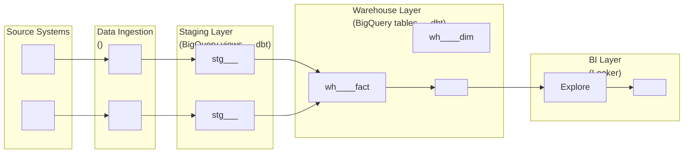

## Auto-Delegation

Follow `specs/utils/precondition_gate.md` before proceeding.

---

# Pipeline Design Generate Command

Follow `specs/utils/data_designer_delegate.md` before executing the workflow below.

## Purpose

Generate a comprehensive data pipeline architecture document covering: source system analysis, replication strategy, data flow, error handling, scheduling, and monitoring approach. Also produces a **Data Flow Diagram (DFD)** as a Mermaid flowchart showing the end-to-end movement of data from source systems through to the BI layer.

## Usage

```bash
/wire:pipeline_design-generate YYYYMMDD_project_name
```

## Prerequisites

- `requirements`: `review: approved`
- `conceptual_model`: `review: approved` — the pipeline design uses approved entities as reference

## Workflow

### Step 1: Verify Prerequisites and Read Inputs

1. Read `.wire/<project_id>/status.md`
2. Verify `requirements.review == approved`. If not:
   ```
   Error: Requirements must be approved before pipeline design.
   Run: /wire:requirements-review <project_id>
   ```
3. Verify `conceptual_model.review == approved`. If not:
   ```
   Error: Conceptual model must be approved before pipeline design.
   The pipeline design maps source systems to the agreed business entities.
   Run: /wire:conceptual_model-review <project_id>
   ```
4. Read `.wire/<project_id>/requirements/requirements_specification.md`
5. Read `.wire/<project_id>/design/conceptual_model.md`
6. Use Glob to find all files in `.wire/<project_id>/artifacts/**/*`
7. Read any source schema examples, SQL files, API documentation, or existing pipeline code in `artifacts/`

### Step 2: Analyse Source Systems

For each source system identified in requirements:
- **Technology**: Database type (SQL Server, PostgreSQL, MySQL, API, flat files, etc.)
- **Schema**: Tables/endpoints relevant to the in-scope entities from the conceptual model
- **Volume**: Row counts, growth rate, transaction frequency
- **Availability**: Uptime, maintenance windows, access method
- **Sensitivity**: PII fields, data governance constraints

Cross-reference source tables/endpoints against the approved conceptual model entities. Flag any entities in the conceptual model that have no clear source system mapping — these are data gaps.

### Step 3: Choose Pipeline Replication Tool

Before defining the per-source replication strategy, the team must align on which tool will manage data replication. Present this as **Design Decision PD-1** (or the next available PD-N if earlier decisions exist):

```
**PD-1: Pipeline Replication Tool**
Context: The choice of replication tool affects connector coverage, cost model,
infrastructure footprint, and ongoing maintenance burden.

Options:

| Option | Best for | Cost model | Connectors | Infrastructure |
|--------|----------|-----------|------------|----------------|
| **Fivetran** | SaaS sources, minimal engineering, managed CDC | MAR-based (Monthly Active Rows) | 500+ pre-built | Fully managed, no infra |
| **dlt (data load tool)** | Python-native teams, custom APIs, cost-sensitive | Open-source / dlt Cloud | Community + custom | Python scripts, self-hosted or dlt Cloud |
| **Airbyte** | Mixed SaaS + custom sources, open-source preference | Open-source / Airbyte Cloud | 350+ connectors | Self-hosted (Docker/K8s) or Airbyte Cloud |
| **Airflow (existing estate)** | A client that already loads data with its own Airflow DAGs (Cloud Composer or self-managed) | The client's Airflow environment | Client's own operators and helpers | The client's Airflow; Wire adds or changes DAGs, never the environment |
| **Custom / bespoke** | Highly specialised sources, full control required | Engineering time | N/A | Self-managed |

Recommendation: [Select based on source systems identified in Step 2 — SaaS-heavy projects
favour Fivetran; Python-heavy or cost-sensitive projects favour dlt]
Input required from: Data Team Lead / CTO
```

If the client has already expressed a tool preference (in requirements or workshops), note it here and skip the decision — but still confirm it is appropriate for all source systems.

**After tool selection: verify connector/source support**

Once the tool is chosen, verify that it can handle each source system identified in Step 2:

- **Fivetran**: Call `mcp__fivetran__list_metadata_connectors` and verify each source system has a matching connector. For any source where a connector is found, call `mcp__fivetran__get_metadata_connector_config` to confirm the required config fields (API keys, OAuth scopes, host/database params) — document these in the design so the implementation step is not blocked by missing credentials.
- **dlt**: Check `dlthub.com/docs/dlt-ecosystem/verified-sources` for verified sources; note which require custom REST source implementation.
- **Airbyte**: Check `docs.airbyte.com/integrations/sources` for connector availability and support tier (Generally Available / Beta / Alpha).
- **Airflow**: Read the client's DAG folder and `.wire/engagement/airflow_environments.yml` (schema in `wire/schemas/airflow-environments-schema.md`). For each source, name the existing DAG that loads it, or say a new DAG is needed and which shared helpers it would use. No live call is made.
- **Custom**: Document the ingestion approach (Cloud Function, Cloud Run job, direct JDBC) per source.

Record the chosen tool in **Section 6 (Technology Stack)** and as `pipeline_tool` in status.md (Step 8).

### Step 4: Define Replication Strategy

For each source system, assess and recommend a replication approach using the chosen tool:

**Replication options** (select based on source capabilities and freshness requirements):
- **Full refresh**: Simple, high-cost at scale, suitable for small/slowly-changing tables
- **Incremental by timestamp**: Efficient, requires a reliable `updated_at` column
- **CDC (Change Data Capture)**: Real-time or near-real-time — supported by Fivetran (log-based), Airbyte (Debezium-based), or custom Debezium setup
- **API polling**: For SaaS sources without database access — all three tools support this
- **Batch extract**: Scheduled SQL exports or file drops — typically custom or dlt

For **Fivetran-based** sources, also include:
- Confirmed connector service slug (from `get_metadata_connector_config`)
- MAR (Monthly Active Rows) estimate and cost implication
- Whether server-side SQL views can reduce MAR by filtering rows at source

For **dlt-based** sources, also include:
- Whether a verified source exists or custom implementation is needed
- Incremental loading strategy (`append`, `merge`, or `replace`)

For **Airbyte-based** sources, also include:
- Connector support tier (GA / Beta / Alpha) and any known limitations
- Sync mode per stream (full refresh / incremental append / incremental deduped)

Present options as numbered scenarios (Scenario A, B, C) where trade-offs exist — do not silently choose. Flag decisions requiring client input as **Design Decision PD-N**.

### Step 5: Define Pipeline Architecture

Specify the end-to-end pipeline:

**Landing / Raw layer**:
- Where replicated data lands (dataset names, schema)
- Naming convention: `fivetran_<source>`, `raw_<source>`, etc.

**Staging layer**:
- dbt staging models that will be built from raw data
- Mapping: raw table → `stg_<source>__<entity>` model name
- Reference the approved conceptual model entities

**Warehouse layer**:
- Fact tables, dimension tables, aggregates
- Reference the data model specification (generated separately)

**Error handling**:
- How pipeline failures are detected and surfaced
- Retry logic
- Alerting approach (Slack, email, monitoring dashboard)

**Scheduling**:
- Refresh cadence per source (real-time, hourly, daily, etc.)
- dbt Cloud job schedules
- Dependencies between pipeline runs and dbt jobs

### Step 6: Document Design Decisions

Apply the reference-legibility convention (`specs/utils/reference_legibility.md`): the bold title line of each decision record (`**PD-N: [Decision Title]**`) is the code's minting site, so any later mention of a PD code in the document resolves against it. Codes cited from other artifacts (e.g. FR-n from the requirements specification) get a first-mention expansion or a Reference key row.

For each decision requiring client input, create a numbered entry:

```
**PD-1: [Decision Title]**
Context: [Why this decision is needed]
Options:
  - Option A: [Description] — [pros/cons, cost implication]
  - Option B: [Description] — [pros/cons, cost implication]
Recommendation: [Preferred option and rationale]
Input required from: [Who needs to decide — DBA, Data Team Lead, CTO, etc.]
```

### Step 7: Generate Data Flow Diagram (DFD)

Produce a Mermaid `graph LR` flowchart showing the complete data flow from source systems to BI dashboards. Write this as a `## Data Flow Diagram` section within the pipeline architecture document.

Use this structure:

```
## Data Flow Diagram


```

Replace all `<placeholders>` with project-specific values from the requirements and conceptual model. Staging model names must match the naming convention (`stg_<source>__<entity>`). Warehouse model names must match the agreed naming convention (`wh_<group>__<entity>_fact`, `wh_<group>__<entity>_dim`).

### Step 8: Write Pipeline Architecture Document

Write to `.wire/<project_id>/design/pipeline_architecture.md`:

```markdown
# Pipeline Architecture: [Project Name]

**Client**: [Client Name]
**Project ID**: [Project ID]
**Generated**: [Date]
**Version**: 1.0

## 1. Source Systems

[Table: System | Technology | In-scope tables/endpoints | Replication method | Refresh cadence]

## 2. Replication Strategy

[Scenarios A/B/C with cost and trade-off analysis]

## 3. Pipeline Architecture

### 3.1 Landing / Raw Layer
[Dataset names, naming convention]

### 3.2 Staging Layer
[dbt staging models — mapping from raw → stg_]

### 3.3 Warehouse Layer
[Fact/dim tables — high level, detail in data_model spec]

### 3.4 Error Handling
[Failure detection, retry, alerting]

### 3.5 Scheduling
[Refresh cadences, dbt job config, dependencies]

## 4. Data Flow Diagram

[Mermaid DFD as generated in Step 6]

## 5. Design Decisions

[PD-1 through PD-N as generated in Step 5]

## 6. Technology Stack

| Layer | Technology | Version/Tier |
|-------|-----------|--------------|
| Replication | [Fivetran/Airbyte/custom] | [connector type] |
| Transformation | dbt Cloud | [dbt version] |
| Warehouse | BigQuery | [dataset location] |
| BI | Looker | [instance URL] |
| Orchestration | [dbt Cloud / Airflow / Cloud Scheduler] | |

## 7. Security and Data Governance

[PII handling, column exclusions, access controls, data residency]
```

### Step 9: Update Status

```yaml
pipeline_design:
  generate: complete
  validate: not_started
  review: not_started
  file: design/pipeline_architecture.md
  generated_date: [today]
pipeline:
  pipeline_tool: [fivetran | dlt | airbyte | airflow | custom]  # chosen in Step 3
```

Write `pipeline_tool` under `artifacts.pipeline` in status.md now, even though the pipeline artifact itself has not been generated yet. This records the design decision so downstream commands can route correctly without re-reading the design document.

### Step 10: Sync to Jira (Optional)

Follow the Jira sync workflow in `specs/utils/jira_sync.md`:
- Artifact: `pipeline_design`
- Action: `generate`
- Status: the generate state just written to status.md

### Step 11: Sync to Document Store (Optional)

If a document store is configured for this project, follow the workflow in `specs/utils/docstore_sync.md`:
- `artifact_id`: `pipeline_design`
- `artifact_name`: `Pipeline Design`
- `file_path`: `.wire/releases/[release_folder]/design/pipeline_architecture.md`
- `project_id`: the release folder path (e.g. `releases/01-discovery`)

If docstore sync fails, log the error and continue — do not block the generate command.

### Step 12: Confirm and Suggest Next Steps

```
## Pipeline Design Generated

**File**: .wire/<project_id>/design/pipeline_architecture.md

**Pipeline tool**: [fivetran | dlt | airbyte | airflow | custom]
**Source systems**: [count]
**Connectors verified**: [count — connectors confirmed to exist in the chosen tool]
**Design decisions requiring input**: [count — flag if > 0, include PD-1 tool choice if unresolved]
**Data flow diagram**: included

### Next Steps

1. Validate the pipeline design:
   /wire:pipeline_design-validate <project_id>

2. After validation, technical review:
   /wire:pipeline_design-review <project_id>

3. Once design is approved, create pipeline connections:
   /wire:pipeline-generate <project_id>

NOTE: If there are open design decisions (PD-N items) — especially PD-1 (tool choice) —
resolve these before or during the review session. The tool choice gates all
downstream pipeline commands.
```

## Edge Cases

### Multiple Viable Replication Scenarios

Always present options — never silently choose. The cost implication (MAR, compute, engineering time) belongs to the client, not the consultant.

### Source Schema Not Available in Artifacts

If source schema examples are absent:
1. Generate the architecture at the entity level (from the conceptual model)
2. Add a note: "Detailed table mapping requires source schema — add SQL schema dumps or query examples to artifacts/ before finalising"
3. List what schema information is needed and who should provide it

### Existing Pipeline in Place

If the client already has a pipeline (e.g. Fivetran partially configured):
1. Document the existing setup in Section 1
2. Design only the incremental additions (new connectors, new tables)
3. Note what must not be changed to avoid breaking existing flows

## Output

This command creates:
- `.wire/<project_id>/design/pipeline_architecture.md` (includes DFD)
- Updates `.wire/<project_id>/status.md`


---

## Depth: `discovery` versus `full`

`--depth full` (the default) is the standing behaviour: the complete pipeline
architecture, including error handling, retry policy, scheduling, alerting and
monitoring.

`--depth discovery` produces a lighter document for a discovery engagement, where
the deliverable is the shape of the platform rather than its operational detail.
It emits:

- Section 1, sources and their landing entities
- The data flow diagram
- Section A below, the target platform architecture

and omits error handling, retry policy, scheduling, alerting and monitoring. Those
sections are stubbed with one line naming the release that will produce them, so a
reader knows they are deliberately absent rather than forgotten.

A `sop_discovery` release under the `modelling_led` profile runs at
`--depth discovery`. Running `--depth full` there is allowed and produces a
document the discovery has not gathered the inputs for, so it warns first.

## Section A: Target platform architecture

The one place Wire writes down *what we propose the platform should be*. In the
`diagnostic` profile this lives in the Solution Initiatives section of
`discovery_analyses`, and the `modelling_led` profile switches that document off,
so it needs a home here.

Not a vendor shortlist and not a cost model. One subsection per layer, each
stating the proposed approach, the reason, and what it rules out:

| Layer | What the subsection settles |
|---|---|
| Ingestion | Managed connectors, code-first, or both, and which sources go which way |
| Storage | Warehouse or lakehouse, and the region and residency constraint that drives it |
| Transformation | The modelling tool and the layering convention it will follow |
| Orchestration | What triggers what, and where dependency and failure are handled |
| Semantic layer | Whether metrics are defined once centrally, in the BI tool, or both, and who owns them |
| Agentic analytics | Whether conversational or agent access is in scope, and what would have to be true first |
| Access and governance | How access is granted, by role or by row, and who administers it |

Each subsection carries a `Constrained by` line naming the appraisal finding
(`CS-n`) or requirement that constrains it, and a `Ruled out` line naming what the
choice forecloses. A layer with no constraint and nothing ruled out has not been
decided, it has been described, and `validate` reports it as
`undecided_layer`.

Where the client has already committed to a component, record it as a given with
who committed and when, rather than presenting it as a choice.


---

## `model_source: modality`

When `status.md` has `model_source: modality`, read the client's existing Modality
model as the input to the sections named below.

What this command takes from the model: Section 1's source list and per-entity landing tables from `sources.mml`. Replication tool and schedule are not in MML and are still asked for. Follow
`specs/utils/mml_import.md` first: it carries the block grammar, the two
vocabularies the specification and the application disagree on, and the
cardinality resolution order.

The model does not replace the requirements. Both are read, and the difference
between them is itself a finding:

- An entity in the model and not in the requirements goes in the excluded list
  with the reason "in the Modality model, not in requirements scope". It is not
  silently carried into scope.
- An entity in the requirements and not in the model goes in the open questions.
  It is not silently added to the model's entity set.

Every value taken from the model cites the `.mml` file it came from. A reader
comparing the Wire document against the model needs to know which claims came from
where, and a later write-back needs to know which claims are new.

`validate` runs the `modality_coverage` check in both directions. Its rules,
including the ones about what absence means, are in `specs/utils/mml_import.md`.
