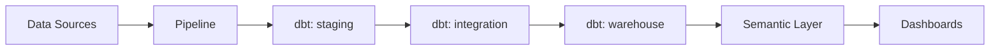

## Auto-Delegation

Follow `specs/utils/precondition_gate.md` before proceeding.

---

# documentation Generate Command

Follow `specs/utils/delivery_lead_delegate.md` before executing the workflow below.

## Purpose

Generate the project's handover documentation: an architecture overview, a data dictionary, and an operational runbook, plus an index linking out to every other generated artifact (dbt docs, semantic layer, dashboards, pipeline, orchestration, deployment). This is the single document a client team member reaches for after the engagement ends — everything in it must point at something that actually exists, not restate content that's better maintained elsewhere.

## Usage

```bash
/wire:documentation-generate YYYYMMDD_project_name
```

## Prerequisites

- Requirements must be approved
- Relevant design artifacts should be complete
- At least one of `dbt`, `pipeline`, `orchestration`, `semantic_layer`, `dashboards`, `deployment` should be complete (there's nothing to document a handover for otherwise — see Edge Cases)

## Workflow

### Step 1: Read Inputs

**Process**:
1. Read `requirements/requirements_specification.md`
2. Read `design/conceptual_model.md`, `design/data_model.md`, `design/pipeline_architecture.md` (whichever exist)
3. Read `status.md` to see which development artifacts (`pipeline`, `orchestration`, `dbt`, `semantic_layer`, `dashboards`, `deployment`) are complete, and their generated file paths
4. Read the dbt project's model descriptions (`schema.yml` files) — these are the source of truth for the data dictionary, not a re-authored copy

### Step 2: Generate Architecture Overview

Summarize the platform's actual shape, sourced from the design and development artifacts read in Step 1 — not invented:
- Data sources and ingestion method (from `pipeline` artifact / `pipeline_design.md`)
- Transformation layers present (from the dbt project's actual staging/integration/warehouse models)
- Orchestration/scheduling approach (from `orchestration` artifact)
- BI/semantic layer (from `semantic_layer` artifact)
- A simple architecture diagram (Mermaid) showing source → pipeline → dbt layers → semantic layer → dashboards, using only components that are actually complete per `status.md`

### Step 3: Generate Data Dictionary

For every warehouse-layer dbt model (and integration models where `schema.yml` descriptions exist):
- Model name, layer, grain, and its `schema.yml` description
- Primary key and foreign key columns
- Link to the model's dbt docs page if a dbt docs site was generated

Do not re-describe columns already documented in `schema.yml` — link/reference them, so the data dictionary can't drift out of sync with the actual model descriptions.

### Step 4: Generate Operational Runbook

- How to re-run the pipeline and dbt models manually (commands, from `pipeline`/`orchestration`/`dbt` artifacts)
- Common troubleshooting scenarios and their fixes (pull from `deployment`'s rollback steps and `data_quality`'s test failure investigation queries, if those artifacts are complete)
- Support/escalation contacts (from `requirements_specification.md`'s stakeholder list, if present)

### Step 5: Generate Artifact Index

A single table linking to every other generated artifact's actual file path (from `status.md`), so this document functions as the entry point for the whole engagement:

| Artifact | File | Status |
|----------|------|--------|
| Data Model | `design/data_model.md` | [status from status.md] |
| dbt Models | dbt docs site link, or `dbt/` directory | [status] |
| Semantic Layer | `development/semantic_layer.md` | [status] |
| Dashboards | `development/dashboards.md` | [status] |
| Deployment Plan | `deploy/deployment_plan.md` | [status] |

### Step 6: Write Documentation File

**File**: `.wire/releases/[release_folder]/enablement/documentation.md`

```markdown
# Project Documentation: [Project Name]

**Generated**: [Date]

## Architecture Overview

[Summary from Step 2]



## Data Dictionary

[Table from Step 3 — links to schema.yml descriptions, not re-authored copies]

## Operational Runbook

### Re-running the Pipeline

[Commands from Step 4]

### Troubleshooting

| Issue | Cause | Fix |
|-------|-------|-----|
| [from deployment rollback steps / data_quality investigation queries] | | |

### Support Contacts

[From requirements_specification.md]

## Artifact Index

[Table from Step 5]
```

### Step 7: Update Status

**Process**:
1. Read `status.md`
2. Update artifacts.documentation section:
   ```yaml
   documentation:
     generate: complete
     validate: not_started
     review: not_started
     generated_date: 2026-02-13
   ```
3. Write updated status.md

### Step 8: Sync to Jira (Optional)

Follow the Jira sync workflow in `specs/utils/jira_sync.md`:
- Artifact: `documentation`
- Action: `generate`
- Status: the generate state just written to status.md

### Step 8.5: Sync to Linear (Optional)

Follow the Linear sync workflow in `specs/utils/linear_sync.md`:
- Artifact: `documentation`
- Action: `generate`
- Status: the generate state just written to status.md

### Step 9: Sync to Document Store (Optional)

If a document store is configured for this project, follow the workflow in `specs/utils/docstore_sync.md`:
- `artifact_id`: `documentation`
- `artifact_name`: `Project Documentation`
- `file_path`: `.wire/releases/[release_folder]/enablement/documentation.md`
- `project_id`: the release folder path (e.g. `releases/01-discovery`)

If docstore sync fails, log the error and continue — do not block the generate command.

### Step 10: Confirm and Suggest Next Steps

**Output**:
```
## documentation Generated Successfully

**Artifacts indexed:** [N]
**Warehouse models in data dictionary:** [N]

**File(s):** .wire/releases/[release_folder]/enablement/documentation.md

### Next Steps

1. **Validate documentation**: `/wire:documentation-validate <project>`
2. After validation, review: `/wire:documentation-review <project>`
```

## Edge Cases

### Prerequisites Not Met

If requirements not approved:
```
Error: Requirements must be approved first.

Current status: [status]

Complete requirements approval: /wire:requirements-review <project>
```

### No Development Artifacts Complete

If none of `pipeline`, `orchestration`, `dbt`, `semantic_layer`, `dashboards`, `deployment` are complete:
```
Error: No development artifacts are complete yet, so there's nothing to document a handover for.

Complete at least one development artifact before generating documentation:
- /wire:dbt-generate <project>
- /wire:pipeline-generate <project>
- /wire:semantic_layer-generate <project>
```

### dbt Models Have No schema.yml Descriptions

If dbt models exist but lack `schema.yml` descriptions to source the data dictionary from:
```
Warning: dbt models exist but several lack schema.yml descriptions.

The data dictionary can only be as complete as the underlying schema.yml files. Models missing descriptions:
- [model list]

Add descriptions via /wire:dbt-generate, then regenerate this documentation, or proceed with a partial data dictionary now? (y/n)
```

## Output

This command creates:
- `.wire/releases/[release_folder]/enablement/documentation.md` — architecture overview, data dictionary, operational runbook, and artifact index
- Updates `status.md`
