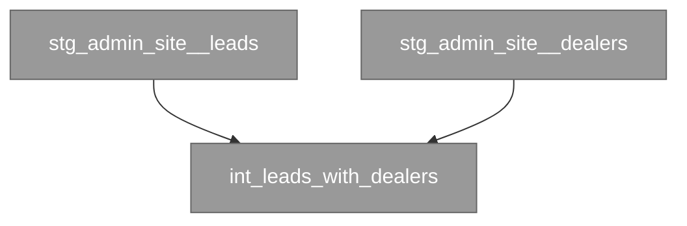

## Auto-Delegation

Follow `specs/utils/precondition_gate.md` before proceeding.
Follow `specs/utils/migration_agent_delegate.md` before executing the workflow below.
Follow `specs/utils/stale_artifact_check.md` with `artifact_id: migration_strategy` and `artifact_file_path: migration/migration_strategy.md` before proceeding.

---

# Migration Strategy — Generate

## Purpose

Translates the approved migration inventory into an actionable execution strategy. Covers the platform-pair translation approach, migration phasing, rollback plan, and the equivalency criteria that will be used to confirm a successful migration before cutover.

## Prerequisites

- `migration/migration_inventory.md` with `review: approved`

## Inputs

- `.wire/releases/$ARGUMENTS/migration/migration_inventory.md`
- `.wire/releases/$ARGUMENTS/migration/migration_batching.md` (optional) — if present with `review: approved`, Step 5b's per-batch DAG generation should note the approved domain batches alongside the existing translation-batch (`dbt_audit.csv` `batch_number`) granularity. These are two different batch concepts — business-domain/cutover slices vs. translation-sequencing groups of ≤20 models — and the strategy doc must not conflate them. If `migration_batching` was never generated, proceed exactly as below with no behaviour change.
- `.wire/releases/$ARGUMENTS/status.md` — source_platform, target_platform
- Canonical platform pair files:
  - BigQuery → Snowflake: `wire/platform_pairs/bigquery_to_snowflake/translation_guide.md`
  - Snowflake → BigQuery: `wire/platform_pairs/snowflake_to_bigquery/translation_guide.md` (quick pattern table) and `translation_reference.md` (exhaustive reference — use its §11 gotcha checklist to scope the silent-behaviour-change risk classes the migration must validate for)
  - Shared: `wire/platform_pairs/dbt_neutral_translation.md` — the macro-first hierarchy and equivalence-testing backbone. Use it to set the per-layer translation approach: how far to push toward dbt-neutral macros (one maintainable project across both warehouses) versus a one-direction rewrite that decommissions the source. Record the decision in the strategy doc.
- **Engagement-level overrides (optional)**: `.wire/engagement/platform_pair_overrides/{pair}/translation_guide.md` — if present, layer on top of the canonical guide. Overrides let a team carry forward bespoke translations from one engagement to the next at the same client.

## Workflow

### Step 1: Load platform pair context

Read the canonical translation guide and type mapping for the active platform pair. Then, if `.wire/engagement/platform_pair_overrides/{pair}/` exists, layer its `translation_guide.md` on top — engagement overrides win where they cover the same construct, and supplement where they introduce new ones. Note any conflicts in the strategy doc under "Translation overrides applied" so the team can see exactly which decisions were taken from where.

These files define the default and engagement-specific translation decisions for all SQL constructs, data types, and configuration patterns.

### Step 2: Draft the translation approach

For each major category of migration work, document the chosen translation approach:

**Data type mapping**: Reference the type mapping file. Flag any types where lossless conversion is not guaranteed (e.g., BIGNUMERIC precision, GEOGRAPHY coordinate system differences).

**SQL dialect translation**: For each platform-specific feature detected in the db_object and dbt audits, document the translation pattern. Where the translation guide provides a macro-based approach, reference the macro. Where a bespoke approach is needed, describe it.

For **snowflake → bigquery** only, decide per layer whether to use the BigQuery Migration Service as an automated first pass before hand-finishing against the guide — see `wire/platform_pairs/snowflake_to_bigquery/bqms_first_pass.md`. It usually pays off for large, mechanical DDL sets and rarely for small or macro-heavy dbt projects. Record the decision here so the target_setup and dbt_migration steps know whether to invoke it.

**dbt configuration translation**:
- `adapter` profile changes
- `dispatch` macro overrides
- **Materialisation**: the default is **faithful preservation** — `dbt-migration-generate` carries each model's resolved materialisation across unchanged (incremental stays incremental with its strategy/partition/cluster, table stays table). Do not set a blanket materialisation default. If this engagement needs to *diverge* from the source — force a materialisation a model didn't have on the source — declare it as policy in a YAML file and point `migration.materialization_overrides_path` (in `status.md`) at it. The file's schema is `default: preserve` plus an `overrides` list of `select` / `exclude` / `force_materialized` rules (see the dbt-migration generate spec). Divergence is an opt-in optimisation, so it lives in engagement policy, never as a Wire default. Record each override rule and its rationale here. Client-specific rule *values* and the file live in the engagement (e.g. `.wire/engagement/<file>.yml`), not in the framework spec.
- Partition/cluster configuration equivalents

**Snapshot migration approach**: For every snapshot in the inventory (the `snapshot` object type), assign a per-snapshot migration strategy. A dbt snapshot is an SCD-2 history table whose closed versions cannot be regenerated from the current source — re-running the snapshot from empty on the target loses all history and breaks any downstream model that reads `dbt_valid_from`/`dbt_valid_to`. Two strategies:

- **`copy_and_continue`** (default, every snapshot unless explicitly overridden): copy the built snapshot table source→target preserving payload + SCD meta columns (`bulk-copy-migration-generate` in carve-out, or the copy path in a full migration), then run `dbt snapshot --select <snap>` once on the target to adopt and continue the history. This preserves every closed version. It is the default because it is the only strategy that keeps history, and it must not require a sign-off.
- **`rebuild_from_T`** (opt-in, requires a recorded data-owner sign-off): abandon the source history and start the target snapshot fresh from the baseline instant `T`. Only legitimate when the data owner has signed off that pre-`T` history is not required (e.g. the snapshot only ever feeds a "current state" consumer, or history is being deliberately reset). Record the signing data owner and date. **Never assign `rebuild_from_T` without a recorded sign-off** — absent a sign-off, the snapshot stays `copy_and_continue`.

Record each snapshot's assigned strategy, and for `rebuild_from_T` the sign-off reference, in this section and in the migration register (`migration-register-generate`). Read the SCD meta-column set and the `dbt_scd_id` continuation invariant from the active pair's **"Snapshot SCD mechanisms"** section — do not hardcode the meta-column types.

**Connector migration**: Whether Fivetran connectors will be cloned to new destinations or new connectors created from scratch on the target.

**Security migration**: How source roles/policies translate to target IAM/roles using the security audit's `translate` and `evaluate` objects.

For **tenant carve-out** (`migration.scope == tenant_carveout`), additionally define the tenant-scoped target IAM model from the security audit's `tenant_scoped` vs `shared` classification:

- **Two-project / tenant-scoped model**: place the extracted tenant's data in its own target project (BigQuery) or database (Snowflake), separated from shared/reference data. Shared roles are recreated platform-wide; `tenant_scoped` roles are granted only on the tenant's project/database.
- **RLS predicate**: for every in-scope table flagged with the tenant key, define the row-level security predicate on that key from `migration.tenant_predicate` (e.g. `tenant_id = 4815`). Record the exact predicate, the tenant-key column, and the IAM principals the policy grants to, so `target-setup-generate` can emit it directly.
- Reuse the platform pair's security mapping rather than inventing a mechanism. For snowflake → bigquery see `wire/platform_pairs/snowflake_to_bigquery/translation_reference.md` §16 — RLS via `CREATE ROW ACCESS POLICY ... FILTER USING`, column masking via Data Catalog policy tags (the same taxonomy used for PII).

When scope is absent or `full_migration`, this tenant block does not apply — security migration is unchanged.

### Step 3: Define migration phases

Divide the migration into sequential phases, each with a defined entry criterion, work items, and exit criterion:

1. **Target setup** — create target warehouse objects (DDL), roles, and permissions
2. **Parallel ingestion** — activate Fivetran connectors to target platform (source connectors remain active)
3. **dbt migration batches** — translate and validate dbt models batch by batch
4. **Orchestration migration** — recreate jobs pointing to target platform
5. **Equivalency validation** — run parallel equivalency checks until all pass
6. **Cutover rehearsal** — execute the full cutover sequence on staging at production scale; record step timings and prove the rollback works
7. **Cutover** — redirect production traffic, then keep source live through the rollback window (default 7–14 days) before a separate decommission step

For each phase, list:
- Dependencies (prior phases that must be complete)
- Estimated duration (from migration inventory effort estimates)
- Rollback procedure (what to do if this phase fails)

### Step 4: Define equivalency success criteria

For each in-scope table and dbt model, define the equivalency checks that must pass before cutover is approved:

- **Row count check**: source count ≈ target count (within tolerance defined per table — default ±0.1%)
- **Schema check**: column names, types, and nullability match
- **Value check**: statistical sampling — mean, min, max, null% for numeric columns; distinct count and null% for string columns
- **Freshness check**: target data is no more than 24 hours behind source (or within the connector sync frequency)
- **dbt tests**: all existing dbt tests pass on the target profile
- **Row-level checksum**: hashed row content matches over the same row set (catches drift that statistical sampling passes — see equivalency validate spec)
- **Business invariants**: define the engagement-specific control totals that must reconcile exactly (or near-exactly) — e.g. total revenue, active customer count, orders per key dimension. List each invariant with its query and tolerance here; the equivalency loop runs them against both platforms.

**Snapshot equivalency (three-layer gate, not row equivalence).** For every snapshot, a SELECT-only row-equivalence check is **not** a sufficient pass criterion — it cannot see SCD-2 continuity. Each snapshot must pass all three layers (defined and enforced in `dbt-migration-validate` / `equivalency-validate`): (a) **copy-parity at `T`** — schema including the SCD meta columns and their ordinal order, row count, and row-level checksum match at the baseline; (b) **continuation behaviour** — after the target `dbt snapshot` run, unchanged rows stay unchanged, changed rows open exactly one new version, hard-deletes are invalidated (when `invalidate_hard_deletes: true`), and a second run is idempotent; (c) **SCD integrity** — `dbt_scd_id` unique, `unique_key` and `dbt_valid_from` not null, no overlapping open versions per key. State this per-snapshot gate here so the equivalency loop knows a snapshot is judged on all three layers, never on row equivalence alone.

Specify the overall success threshold: cutover is unblocked when `checks_failing == 0` across all in-scope objects. Define how partial failures are handled (per-table hold vs full stop).

#### Define the frozen equivalency baseline

Equivalency must compare two *pinned* states, not two moving platforms — the source keeps ingesting and the target keeps loading, so a live-vs-live comparison surfaces timing differences, not translation differences. Define the baseline here; `dbt-migration-generate` builds against it and `equivalency-validate` compares against it (this is the "baseline defined in the migration strategy's equivalency section" that `reverse-etl-migration` and others reference).

Specify:

- **Baseline instant `T`** — a single cutoff timestamp (UTC). Both sides are pinned to `T`. Record how `T` is chosen (e.g. a quiet point after a completed Fivetran sync round).
- **Source pin (Snowflake)** — a **zero-copy clone at `T`**: `CREATE … CLONE … AT (TIMESTAMP => '<T>')` (or a time-travel read `AT (TIMESTAMP => '<T>')`) into a read-only `wire_baseline` schema. The clone is frozen, so continued source ingestion does not move the comparison. Record the clone location.
- **Target pin (BigQuery)** — a **Bronze watermark ≤ `T`**: for each Fivetran-landed table, the comparison includes only rows with `_fivetran_synced <= '<T>'` (or the equivalent loaded-at column), so the target reflects exactly what had landed by `T`. Record the per-connector watermark column.
- **Determinism** — both sides must be reproducible at `T`: no `CURRENT_TIMESTAMP`/`CURRENT_DATE`-relative logic, fixed sampling seeds. Models whose logic is time-relative are listed here so the deterministic-build switch can pin them.
- **Expected type-translation allow-list** — the cross-platform type changes that are *correct* and must not be flagged as value drift: e.g. `VARIANT → JSON`/`STRING`, `TIMESTAMP_NTZ → DATETIME`, `NUMBER`-scale rounding. List each with the normalisation applied before comparison.

`equivalency-validate` runs in **baseline-pin mode** against this definition. Record `T`, the clone location, the watermark columns, and the source repo commit so every equivalency result is reproducible.

### Step 5: Write the strategy document

**Output location**: `.wire/releases/$ARGUMENTS/migration/migration_strategy.md`

Use the template at `TEMPLATES/migration/migration_strategy.md`. Include:
- Platform pair summary
- Translation approach by category
- **Snapshot migration** object-type section: one row per snapshot with its assigned strategy (`copy_and_continue` / `rebuild_from_T`), and for every `rebuild_from_T` the recorded data-owner sign-off (name + date). State the default (`copy_and_continue`) and that `rebuild_from_T` never appears without a sign-off.
- Phase plan with timelines and rollback procedures
- Equivalency success criteria
- Risk register (top 5 risks with likelihood, impact, mitigation)
- Go/no-go checklist for cutover

### Step 5b: Generate per-batch migration DAGs

For each batch defined in the migration phases (or from `audit/dbt_audit.csv` if available at this stage), generate a Mermaid batch DAG file.

**Output location per batch**: `.wire/releases/$ARGUMENTS/artifacts/migration_strategy/dag_batch_{N}.md`

Create the directory if it doesn't exist. One file per batch. Each file is a standalone Mermaid flowchart — it will be updated in-place by `/wire:dbt-migration-generate` as models progress through the translation and equivalency loop.

**DAG format**:

```markdown
# Migration Batch {N} — Model DAG

*Status last updated: {TODAY}*
*Legend: ⬜ not started · 🟠 translated · ✅ passed · ❌ failed*


```

**Building the DAG**:

1. Source the model list for each batch from `audit/dbt_audit.csv` (column `batch_number`). If the audit CSV is not yet available, use the batch groupings defined in the migration phases (Step 3 above) as a placeholder — one node per model listed in the phase work items.

2. Build edges from `ref()` dependencies:
   - **Preferred**: read `<migration.dbt_project_path>/target/manifest.json` — it contains `depends_on.nodes` edges for every model.
   - **Fallback**: scan each model `.sql` for `ref(...)` calls to derive edges.
   - Only show edges where both the parent and child are **in the same batch**. For cross-batch dependencies (parent in batch M, child in batch N > M), add a dashed edge from an external reference node:

     ```
     ext_batch_M_model_x([model_x · batch M]):::notStarted
     ext_batch_M_model_x -.-> model_y
     ```

3. Initial state for all nodes: `:::notStarted` (grey). Do not assign any other state at strategy time — states are updated by `/wire:dbt-migration-generate` as the migration runs.

4. Node labels: use the model name (without schema prefix). Sanitise for Mermaid: replace `__` with `_`, avoid parentheses in node IDs. Use `[label]` (rectangular) for standard models, `([label])` (stadium) for external reference nodes, `{label}` (diamond) for models flagged `low` confidence in the dbt audit.

**Update the strategy document** (`migration_strategy.md`) to include a reference section listing all batch DAG files:

```markdown
## Migration Batch DAGs

Visual progress tracker for each migration batch. Updated automatically by `/wire:dbt-migration-generate`.

| Batch | File | Models |
|-------|------|--------|
| 1 | `artifacts/migration_strategy/dag_batch_1.md` | N models |
| 2 | `artifacts/migration_strategy/dag_batch_2.md` | N models |
```

### Step 6: Update status

```yaml
artifacts:
  migration_strategy:
    generate: complete
    file: migration/migration_strategy.md
    generated_date: "{{TODAY}}"
```

### Step 7: Output next command

```
/wire:migration-strategy-validate $ARGUMENTS
```

## Output Files

- `.wire/releases/$ARGUMENTS/migration/migration_strategy.md`
- Updated `.wire/releases/$ARGUMENTS/status.md`


## Post-Execution Hooks

After updating `status.md`, run these in sequence:

1. **Execution log** — Append one row to `.wire/releases/$ARGUMENTS/execution_log.md` following `specs/utils/execution_log.md`.

2. **Jira sync** — Follow `specs/utils/jira_sync.md`. Pass `$ARGUMENTS` as project_folder, `migration_strategy` as artifact, `generate` as action.

3. **Document store** — Follow `specs/utils/docstore_sync.md`. Pass `$ARGUMENTS` as project_folder, `migration_strategy` as artifact_id, `Migration Strategy` as artifact_name, and the `file` value from `artifacts.migration_strategy` in status.md as file_path.

4. **Auto-commit** — Follow `specs/utils/commit.md`. Pass `$ARGUMENTS` as release_folder, `migration_strategy` as artifact, `generate` as action.
